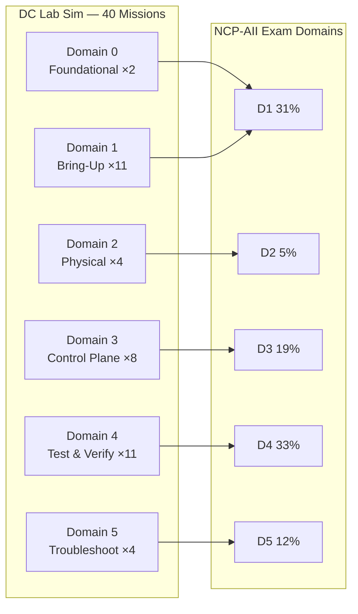
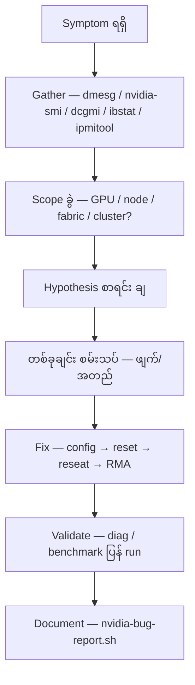

# Module 16 — Mission-by-Mission Playbooks (40 Missions)

## 1. ပြဿနာ — generic practice ထက် mission-by-mission ပြင်ဆင်ခြင်း ဘာကြောင့် ပိုကောင်းသလဲ

လေ့ကျင့်သူ အများစုသည် command တစ်လုံးချင်းစီ တတ်ပြီးသွားပြီးနောက်
"မေးခွန်းအမျိုးမျိုး ဖြေကြည့်ခြင်း" ဖြင့် ပြင်ဆင်လေ့ ရှိပါသည်။ သို့သော်
NCP-AII စာမေးပွဲနှင့် တကယ့် datacenter လုပ်ငန်းခွင်တွင် မေးလေ့ရှိသည်မှာ
"command ဘာလဲ" မဟုတ်ဘဲ **"symptom တစ်ခု ရလာလျှင် ဘယ်အဆင့်က စပြီး
ဘယ်လို ချဉ်းကပ်မလဲ"** ဖြစ်ပါသည်။

DC Lab Sim ၏ **40 missions** သည် ဤ ချဉ်းကပ်နည်းကို လေ့ကျင့်ပေးပါသည် —
တစ်ခုချင်းစီသည် ဇာတ်လမ်းတစ်ပုဒ် (story) နှင့် လာပြီး ဖြေရှင်းမှသာ
အောင်မြင်ပါသည်။ mission-by-mission ပြင်ဆင်ခြင်း၏ အားသာချက်များ —

- **fault class အလိုက် ကျွမ်းကျင်မှု ရ** — XID hang, thermal, ECC, NVLink,
  fiber/speed-degrade, bonding, BIOS, driver/firmware, Fabric Manager, Slurm,
  container, storage, NCCL, HPL, DCGM — စသည်ဖြင့် ဧရိယာအလိုက် သီးခြား ကျွမ်းကျင်
- **triage muscle memory** — symptom တွေ့လျှင် ပထမဆုံး ဘာကြည့်ရမည် ဆိုသည်ကို
  အလိုအလျောက် သိလာ
- **အားနည်းရာ ဧရိယာ ဖော်ထုတ်နိုင်** — mission တစ်ခုချင်း၏ ရလဒ်က ဘယ် domain တွင်
  အားနည်းသည်ကို တိတိကျကျ ပြ
- **စာမေးပွဲ format နှင့် နီးစပ်** — Exam Gauntlet (weighted scenarios) က
  mission-based scenario များကိုပင် အခြေခံထားခြင်း

## 2. Concept — Missions များက exam domains များနှင့် ဘယ်လို ကိုက်ညီသလဲ

DC Lab Sim ၏ mission ၄၀ ကို **5 domains** ခွဲထားပြီး ၎င်းတို့သည် NCP-AII စာမေးပွဲ၏
domain weighting နှင့် တိုက်ရိုက် ကိုက်ညီပါသည်။

| Domain | အမည် | Mission အရေအတွက် | Exam weight |
|---|---|---|---|
| Domain 0 | Foundational Skills | 2 | (foundation — weighted မဟုတ်) |
| Domain 1 | Systems & Server Bring-Up | 11 | 31% |
| Domain 2 | Physical Layer Management | 4 | 5% |
| Domain 3 | Control Plane Installation | 8 | 19% |
| Domain 4 | Cluster Test & Verification | 11 | 33% |
| Domain 5 | Troubleshooting & Optimization | 4 | 12% |

> Exam weight များသည် စာမေးပွဲ အချိုးအစား ဖြစ်ပြီး mission အရေအတွက်နှင့်
> မတူနိုင်ပါ — Domain 4 သည် weight အများဆုံး (33%) ဖြစ်၍ validation များကို
> အချိန်အများဆုံး ပေးသင့်ပါသည်။

Domain 1 (31%) + Domain 4 (33%) = စာမေးပွဲ၏ ၆၄% ဖြစ်သဖြင့်
bring-up (firmware → driver → Fabric Manager → IB) နှင့် validation
(NCCL/HPL/DCGM/certification) သည် အဓိက စစ်မျက်နှာ ၂ ခု ဖြစ်ပါသည်။

**Figure 1 — Missions အုပ်စုများနှင့် NCP-AII exam domains mapping**



**ပုံရှင်းလင်းချက်** — ပုံ၏ ဘယ်ဘက်တွင် simulator ၏ mission အုပ်စု ၆ ခု ရှိပြီး
ညာဘက်တွင် စာမေးပွဲ domain များနှင့် weight များ ရှိပါသည်။ မြားများက
Domain 0 သည် Domain 1 ၏ အခြေခံ ဖြစ်ကြောင်း (terminal မတတ်လျှင် bring-up
mission များ မလုပ်နိုင်) နှင့် Domain 1–5 တစ်ခုချင်းစီသည် စာမေးပွဲ domain
တစ်ခုချင်းစီနှင့် တိုက်ရိုက် ကိုက်ညီကြောင်း ပြပါသည်။ လေ့ကျင့်ရာတွင်
ပုံ၏ ဘယ်ဘက် အစဉ်အတိုင်း သွားပါက ညာဘက် domain အားလုံး ဖုံးလွှမ်းပါမည်။

## 3. Mission Catalog — 40 Scenarios အပြည့်အစုံ

| # | Mission | Domain | Difficulty | Est. time |
|---|---|---|---|---|
| 1 | Terminal Bootcamp: Getting Around | 0 | beginner | 12m |
| 2 | Terminal Bootcamp: Output Filtering | 0 | beginner | 13m |
| 3 | The Rack Expansion | 1 | beginner | 28m |
| 4 | The BIOS Verification | 1 | beginner | 15m |
| 5 | First Light: Bringing a DGX Node Online | 1 | beginner | 20m |
| 6 | Driver & Firmware Validation | 1 | beginner | 20m |
| 7 | The Midnight Deployment | 1 | intermediate | 25m |
| 8 | The Firmware Emergency | 1 | intermediate | 20m |
| 9 | The Fabric Manager Awakening | 1 | intermediate | 20m |
| 10 | Network Bonding Blues | 1 | intermediate | 20m |
| 11 | Wiring the Fabric: InfiniBand Initialization | 1 | intermediate | 20m |
| 12 | NVLink & Fabric Manager Activation | 1 | intermediate | 20m |
| 13 | The Driver Disaster | 1 | advanced | 22m |
| 14 | The Fiber Optic Fault | 2 | beginner | 15m |
| 15 | The Fabric Health Check | 2 | intermediate | 20m |
| 16 | The NVLink Mystery | 2 | advanced | 25m |
| 17 | The PCIe Puzzle | 2 | advanced | 23m |
| 18 | The Slurm Setup | 3 | beginner | 25m |
| 19 | The Container Crisis | 3 | intermediate | 20m |
| 20 | The Storage Showdown | 3 | intermediate | 22m |
| 21 | The Job Scheduler Setup | 3 | intermediate | 25m |
| 22 | Container Orchestration | 3 | intermediate | 20m |
| 23 | The Storage Architect | 3 | intermediate | 20m |
| 24 | Standing Up the Scheduler: Slurm Partitions & Health | 3 | intermediate | 20m |
| 25 | Container Runtime: Docker, Enroot & Pyxis with NGC | 3 | intermediate | 22m |
| 26 | The Bandwidth Bottleneck | 4 | intermediate | 23m |
| 27 | The Health Inspector | 4 | intermediate | 20m |
| 28 | The Silent Cluster | 4 | advanced | 25m |
| 29 | The NCCL Nightmare | 4 | advanced | 24m |
| 30 | The Benchmark Battle | 4 | advanced | 26m |
| 31 | The NCCL Championship | 4 | advanced | 25m |
| 32 | Linpack Showdown | 4 | advanced | 25m |
| 33 | Fabric Under Pressure | 4 | advanced | 25m |
| 34 | The Cluster Certification | 4 | advanced | 30m |
| 35 | Validation: Multi-Node NCCL All-Reduce | 4 | advanced | 25m |
| 36 | Validation: DCGM Diagnostic Levels & ECC Baseline | 4 | advanced | 25m |
| 37 | The Memory Mystery | 5 | intermediate | 22m |
| 38 | The XID Investigation | 5 | advanced | 24m |
| 39 | The Network Nightmare | 5 | advanced | 25m |
| 40 | Cable Detective | 5 | advanced | 25m |

## 4. Playbook တစ်ခုချင်းစီ၏ ဖွဲ့စည်းပုံ

အောက်ပါ mission playbook တစ်ခုချင်းစီတွင် အပိုင်း ၅ ခု ပါရှိပါသည် —

- **Story** — mission brief (site ၏ ဇာတ်လမ်း အကျဉ်း)
- **ဖြစ်နိုင်ချေရှိသော ဧရိယာ (likely focus)** — မည်သည့် fault class / skill ကို
  လေ့ကျင့်ပေးသည်
- **ချဉ်းကပ်နည်း (approach)** — ဇာတ်လမ်း ဘယ်လိုပဲ ဖြစ်ဖြစ် အလုပ်လုပ်မည့်
  triage/bring-up လမ်းကြောင်း (၃–၅ ဆင့်)
- **အဓိက commands** — course ၏ command families မှ ၃–၆ ခု
- **သတိပြုရန် (pitfall)** — အဖြစ်များသော ထောင်ချောက် တစ်ခု

> ⚠️ simulator ၏ အတိအကျ injected faults များကို အများပြည်သူ မသိရှိရသေးပါ —
> ထို့ကြောင့် focus ဧရိယာများကို "**ဖြစ်နိုင်ချေ**" ဟုသာ ဖော်ပြထားပြီး
> ချဉ်းကပ်နည်းများကို fault အမျိုးအစား မည်သို့ ဖြစ်စေ အလုပ်လုပ်မည့်
> robust triage အဖြစ် ရေးထားပါသည်။ mission-scoring အတွင်းပိုင်း ယန္တရားများကို
> ခန့်မှန်း မရေးပါ။

---

# Mission Playbooks

## Domain 0 — Foundational Skills (2 missions)

### 1. Terminal Bootcamp: Getting Around (beginner, ~12 min)

- **Story** — datacenter တွင် ပထမဆုံး အလုပ်ဝင်ရက် — shift မစမီ terminal ကို
  အရင် တတ်မြောက်ရန် လိုအပ်နေသည်။
- **ဖြစ်နိုင်ချေရှိသော ဧရိယာ (likely focus)** — terminal navigation နှင့်
  command execution အခြေခံ — မှန်ကန်သော command ကို မှန်ကန်သော နေရာတွင်
  run တတ်ခြင်း၊ output ကို ဖတ်တတ်ခြင်း။
- **ချဉ်းကပ်နည်း (approach)**
  1. mission brief ကို ဖတ်ပြီး ဘာ စစ်ဆေးခိုင်းသည် စာရင်း ပြုလုပ်
  2. `nvidia-smi` ကဲ့သို့ အခြေခံ state command ဖြင့် စတင် အခြေအနေ ကြည့်
  3. `sinfo`, `ipmitool sensor list` ဖြင့် cluster/BMC ဘက် ဆက်စစ်
  4. တွေ့ရှိချက် တစ်ခုချင်းကို မှတ်တမ်းတင်ပြီး mission အဆုံးသတ်
- **အဓိက commands** — `nvidia-smi`, `nvidia-smi -q`, `sinfo`,
  `ipmitool sensor list`, `nvsm show health`
- **သတိပြုရန် (pitfall)** — command တစ်ခုတည်း ကြည့်ပြီး ကောင်းကြောင်း
  ကောက်ချက် မချပါနှင့် — `nvidia-smi` က GPU ပြသော်လည်း node/fabric
  အခြေအနေကို မပြပါ။

### 2. Terminal Bootcamp: Output Filtering (beginner, ~13 min)

- **Story** — ဒုတိယနေ့ — cluster alert တစ်ခုကို triage လုပ်ရန် output
  filtering ကို ကျွမ်းကျင်အောင် လေ့ကျင့်ရမည်။
- **ဖြစ်နိုင်ချေရှိသော ဧရိယာ (likely focus)** — output parsing/filtering
  (`grep`, `|` pipe) ဖြင့် error/keyword ကို အမြန် ရှာတွေ့ခြင်း —
  XID/error keyword filtering၊ alert source ဖော်ထုတ်ခြင်း။
- **ချဉ်းကပ်နည်း (approach)**
  1. alert တွင် ပါသော keyword (XID? thermal? link?) ကို သတ်မှတ်
  2. `dmesg | grep -i xid` ကဲ့သို့ filtered command ဖြင့် log ရှာ
  3. `nvidia-smi --query-gpu=... --format=csv` ကဲ့သို့ column filter ဖြင့်
     လိုအပ်သော ကိန်းဂဏန်းများသာ ထုတ်
  4. ရလဒ် filter ကို ပြန်စစ် — မှားယွင်းသော filter က အမှား ဖုံးကွယ်နိုင်
- **အဓိက commands** — `dmesg | grep -i xid`, `nvidia-smi --query-gpu=... --format=csv`,
  `nvidia-smi dmon`, `dcgmi dmon -e 1001,1002`
- **သတိပြုရန် (pitfall)** — `grep` pattern ကျဉ်းလွန်းပါက error အသစ်
  မမိနိုင်ပါ — case-insensitive (`-i`) နှင့် ကျယ်သော pattern သုံးပါ။

## Domain 1 — Systems & Server Bring-Up (31% of exam, 11 missions)

### 3. The Rack Expansion (beginner, ~28 min)

- **Story** — DGX node အသစ် ၄ လုံးက training cluster capacity ကို 50% တိုးချဲ့ရန်
  ရောက်ရှိလာသည်။
- **ဖြစ်နိုင်ချေရှိသော ဧရိယာ (likely focus)** — multi-node rack installation နှင့်
  node-by-node bring-up checklist — physical install, power-on, inventory,
  initial validation တစ်ခုလုံး။
- **ချဉ်းကပ်နည်း (approach)**
  1. node အသစ် တစ်လုံးချင်းစီအတွက် inventory စစ် — `dmidecode`,
     `ipmitool sensor list`
  2. `nvidia-smi` ဖြင့် GPU အားလုံး မြင်ရမှု စစ် — node တစ်လုံးချင်း မကျန်စေရ
  3. `dcgmi discovery -l` ဖြင့် GPU အရေအတွက် အတည်ပြု
  4. `ibstat` ဖြင့် fabric link ပါ ပါ/မပါ ကြိုစစ်
  5. node အားလုံး ပြီးမှ cluster အဆင့် `nvsm show health` ဖြင့် အနှစ်ချုပ်
- **အဓိက commands** — `dmidecode`, `ipmitool sensor list`, `nvidia-smi`,
  `dcgmi discovery -l`, `ibstat`, `nvsm show health`
- **သတိပြုရန် (pitfall)** — node ၄ လုံးကို တစ်ပြိုင်နက် စစ်ပါက ဘယ် node
  တွင် ပြဿနာ ရှိသည် ရောမိနိုင် — node တစ်လုံးချင်း အဆင့် ခွဲမှတ်ပါ။

### 4. The BIOS Verification (beginner, ~15 min)

- **Story** — server အသစ်များကို production workload မဝင်မီ UEFI/BIOS settings
  နှင့် firmware ကို deployment checklist နှင့် ကိုက်ညီအောင် စစ်ဆေးရမည်။
- **ဖြစ်နိုင်ချေရှိသော ဧရိယာ (likely focus)** — BIOS/UEFI checklist validation —
  firmware version, BIOS settings (power profile, PCIe config) ကို standard
  နှင့် နှိုင်းယှဉ်ခြင်း။
- **ချဉ်းကပ်နည်း (approach)**
  1. `dmidecode` ဖြင့် BIOS version နှင့် system inventory ထုတ်
  2. `nvidia-smi -q` ဖြင့် GPU firmware (VBIOS) နှင့် PCIe info စစ်
  3. deployment checklist နှင့် တစ်ခုချင်း ကိုက်/မကိုက် မှတ်
  4. မကိုက်သော item ကို ပြင်ဆင်ပြီး power cycle ပြန်စစ်
- **အဓိက commands** — `dmidecode`, `nvidia-smi -q`, `ipmitool sensor list`,
  `ipmitool chassis power cycle`
- **သတိပြုရန် (pitfall)** — BIOS setting ပြောင်းပြီး ချက်ချင်း မကြည့်ဘဲ
  ဆက်သွားပါက — ပြောင်းလဲမှု အများစုက reboot/power cycle ပြီးမှ ထိရောက်ပါသည်။

### 5. First Light: Bringing a DGX Node Online (beginner, ~20 min)

- **Story** — DGX A100 node အသစ် တစ်လုံး rack ထဲ ရောက်လာသည် — ဘာမှ
  configure မလုပ်ရသေး — cold metal မှ GPU-ready အထိ တင်ရမည်။
- **ဖြစ်နိုင်ချေရှိသော ဧရိယာ (likely focus)** — full bring-up sequence —
  power-on → BIOS/firmware → OS/driver → GPU visibility → Fabric Manager →
  validation အဆင့်စဉ်။
- **ချဉ်းကပ်နည်း (approach)**
  1. `ipmitool chassis power status` / `ipmitool sensor list` — power နှင့်
     hardware state အရင်
  2. `dmidecode`, `nvidia-smi -q` — firmware/driver version များ မှတ်
  3. `nvidia-smi` — GPU ၈ လုံး အားလုံး မြင်ရမှု အတည်ပြု
  4. Fabric Manager အခြေအနေ စစ် — မလုပ်ရသေးပါက start (mission 12 ကို ကြည့်)
  5. `dcgmi diag -r 1` ဖြင့် quick validation ဖြင့် အဆုံးသတ်
- **အဓိက commands** — `ipmitool chassis power status`, `dmidecode`,
  `nvidia-smi`, `nvidia-smi -q`, `dcgmi diag -r 1`
- **သတိပြုရန် (pitfall)** — bring-up အဆင့်စဉ်ကို ကျော်ပါက (ဥပမာ driver
  မတပ်ဘဲ validation) နောက်ပိုင်း အဆင့်များတွင် error များ ရှုပ်ထွေးလာပါမည် —
  အဆင့်စဉ်အတိုင်း သွားပါ။

### 6. Driver & Firmware Validation (beginner, ~20 min)

- **Story** — node က power on ကောင်းကောင်း တက်သည် — သို့သော် "power on" က
  "production-ready" မဟုတ်။ cluster standard ဖြစ်သော firmware/software version
  များ ဖြစ်ကြောင်း သက်သေပြရမည်။
- **ဖြစ်နိုင်ချေရှိသော ဧရိယာ (likely focus)** — driver/firmware version
  validation — version mismatch (XID 38 ကဲ့သို့) ဖြစ်နိုင်ချေ၊ version matrix
  နှင့် ကိုက်ညီမှု စစ်ဆေးခြင်း။
- **ချဉ်းကပ်နည်း (approach)**
  1. `nvidia-smi -q` — driver version နှင့် GPU firmware (VBIOS) ထုတ်
  2. `dmidecode` — system BIOS/BMC version ထုတ်
  3. cluster version matrix (standard) နှင့် တစ်ခုချင်း နှိုင်းယှဉ်
  4. `dmesg | grep -i xid` — version mismatch XID 38 ရှိ/မရှိ စစ်
  5. မကိုက်ပါက firmware/driver ကို standard version သို့ ပြင်ပြီး ပြန်စစ်
- **အဓိက commands** — `nvidia-smi -q`, `dmidecode`, `dmesg | grep -i xid`,
  `dcgmi diag -r 1`
- **သတိပြုရန် (pitfall)** — "node က အလုပ်လုပ်နေသည်" ဆိုရုံနှင့် version
  မှန်သည် မဟုတ်ပါ — mismatch က load ကျမှ မှ ပေါ်လာတတ်ပါသည်။

### 7. The Midnight Deployment (intermediate, ~25 min)

- **Story** — DGX A100 cluster အသစ် ည ၁၁ နာရီ ရောက်လာသည် — deployment
  deadline က မနက် ၈ နာရီ။
- **ဖြစ်နိုင်ချေရှိသော ဧရိယာ (likely focus)** — time-boxed bring-up —
  deadline အတွင်း node အားလုံးကို bring-up order အတိုင်း တက်စေခြင်း
  (BIOS → firmware → driver → Fabric Manager → IB init → validation)။
- **ချဉ်းကပ်နည်း (approach)**
  1. အချိန်ကို ခွဲဝေ — node အရေအတွက်နှင့် အဆင့်စဉ်အလိုက် budget သတ်မှတ်
  2. node တစ်လုံးကို pilot အဖြစ် အပြီး bring-up လုပ် — checklist အတိုင်း မှတ်
  3. pilot node ပေါ် အောင်မြင်သော အဆင့်စဉ်ကို node ကျန်များတွင် ပုံတူကူး
  4. node တစ်လုံးချင်း `nvidia-smi` + `dcgmi diag -r 1` ဖြင့် အတည်ပြု
  5. ကျန်ခဲ့သော node ကို အဆုံးသတ်မီ `nvsm show health` ဖြင့် cluster အနှစ်ချုပ်
- **အဓိက commands** — `nvidia-smi`, `dcgmi diag -r 1`, `ibstat`,
  `nvsm show health`, `sinfo`
- **သတိပြုရန် (pitfall)** — node အားလုံးကို တစ်ပြိုင်နက် စတင်ပြီး
  ပြဿနာ တက်လာပါက ဘယ်အဆင့်တွင် ရပ်သွားသည် ရှုပ်သွားပါမည် — pilot
  node တစ်လုံး အရင် ပြီးအောင် လုပ်ပါ။

### 8. The Firmware Emergency (intermediate, ~20 min)

- **Story** — security bulletin ကြောင့် production node ၈ လုံးလုံးတွင် firmware
  update ကို ချက်ချင်း လုပ်ရန် လိုအပ်နေသည်။
- **ဖြစ်နိုင်ချေရှိသော ဧရိယာ (likely focus)** — fleet-wide firmware update
  procedure — version inventory စုခြင်း၊ update အဆင့်စဉ်၊ update ပြီးမှ
  validation ပြန်လုပ်ခြင်း။
- **ချဉ်းကပ်နည်း (approach)**
  1. node အားလုံး၏ လက်ရှိ firmware version ကို `dmidecode`, `nvidia-smi -q`
     ဖြင့် စု — ဘယ် version က ဘယ် node တွင် ရှိသည် ဇယား လုပ်
  2. bulletin ၏ target version နှင့် နှိုင်းယှဉ် — affected node များ သတ်မှတ်
  3. firmware update ကို node တစ်လုံး (canary) ဖြင့် အရင် စမ်း —
     update procedure သည် firmware category command များကို အသုံးပြု
     (Docs > Commands — Firmware)
  4. canary အောင်မြင်မှ node ကျန်များ ဆက်လုပ်
  5. update ပြီးတိုင်း `dcgmi diag -r 2` ဖြင့် ပြန်စစ် — firmware update က
     GPU/fabric state ကို ပြောင်းစေနိုင်
- **အဓိက commands** — `dmidecode`, `nvidia-smi -q`, `dcgmi diag -r 2`,
  `dmesg | grep -i xid`, `ipmitool chassis power cycle`
- **သတိပြုရန် (pitfall)** — production node များပေါ်တွင် firmware update က
  workload ကို ဖျက်ဆီးနိုင် — maintenance window နှင့် အလုပ်ရှင် ကြိုတင်
  အသိပေးခြင်း မလုပ်ဘဲ မလုပ်ပါနှင့်။

### 9. The Fabric Manager Awakening (intermediate, ~20 min)

- **Story** — DGX cluster အသစ် တစ်ခုလုံးသည် OS install ပြီးသော်လည်း Fabric
  Manager ကို ဘယ်တော့မှ မ start ခဲ့သဖြင့် idle ဖြစ်နေသည်။
- **ဖြစ်နိုင်ချေရှိသော ဧရိယာ (likely focus)** — Fabric Manager service
  state — NVSwitch fabric မ initialized ဖြစ်ခြင်းက GPU-to-GPU bandwidth ကို
  ကျဆင်းစေခြင်း။
- **ချဉ်းကပ်နည်း (approach)**
  1. `nvidia-smi nvlink -s` — NVLink link များ Active ဖြစ်/မဖြစ် စစ်
     (Inactive များး တွေ့ပါက Fabric Manager သံသယ)
  2. Fabric Manager service အခြေအနေ စစ်ပြီး မလုပ်ရသေးပါက start
     (`systemctl restart nvidia-fabricmanager`)
  3. `nvidia-smi topo -m` — topology ပုံမှန် ပြန်ဖြစ်မှု အတည်ပြု
  4. `nvidia-smi nvlink -s` ပြန်စစ် — link အားလုံး Active
  5. single-node NCCL test (mission 35 ကို ကြည့်) ဖြင့် bandwidth အတည်ပြု
- **အဓိက commands** — `nvidia-smi nvlink -s`, `systemctl restart nvidia-fabricmanager`,
  `nvidia-smi topo -m`, `nvidia-smi`, `dcgmi diag -r 1`
- **သတိပြုရန် (pitfall)** — Fabric Manager မရှိပါက GPU များ ပေါ်နေသေးပြီး
  job တွေ တစ်ဝက်လောက် အလုပ်လုပ်သလို ထင်ရနိုင် — `nvidia-smi` တစ်ခုတည်းနှင့်
  ကျေနပ်ပြီး fabric ကို မစစ်မိပါက ဖုံးကွယ်နေပါမည်။

### 10. Network Bonding Blues (intermediate, ~20 min)

- **Story** — rack installation ပြီးသော cluster node အသစ်များတွင် Ethernet
  bonding မှားယွင်းနေပြီး InfiniBand port များ idle ဖြစ်နေသည်။
- **ဖြစ်နိုင်ချေရှိသော ဧရိယာ (likely focus)** — Ethernet bonding misconfiguration
  နှင့် IB port မ up ခြင်း — network config နှစ်မျိုးလုံး တစ်ပြိုင်နက်
  ပြန်ညှိရခြင်း။
- **ချဉ်းကပ်နည်း (approach)**
  1. `ipmitool sensor list` ဖြင့် hardware link state အရင် ဖယ်ရှား
  2. `ibstat` — IB port အလိုက် state (Active/Down) နှင့် rate စစ်
  3. Ethernet bonding config ကို စစ် — bond mode/slave membership မှားနေပါက
     ပြင်ပြီး network service ပြန်တင်
  4. IB port အတွက် — link up မဟုတ်ပါက physical/cable ဘက် (mission 14)
     သို့မဟုတ် config ဘက် ခွဲစစ်
  5. `ibstat` ပြန် run — Active + မျှော်မှန်းထားသော rate ရရှိမှ ပြီး
- **အဓိက commands** — `ibstat`, `ipmitool sensor list`, `nvidia-smi`,
  `nvsm show health`, `dmesg | grep -i xid`
- **သတိပြုရန် (pitfall)** — bonding ပြဿနာကို ပြင်ရင်း IB ပြဿနာ မေ့သွားတတ် —
  မစတင်မီ ပြဿနာ ၂ ခုလုံးကို စာရင်း ချပြီး တစ်ခုချင်း ပိတ်ပါ။

### 11. Wiring the Fabric: InfiniBand Initialization (intermediate, ~20 min)

- **Story** — compute က တက်နေပြီ — သို့သော် isolated node က distributed training
  အတွက် အသုံးဝင်မည် မဟုတ်။ high-speed fabric ကို online တင်ရမည်။
- **ဖြစ်နိုင်ချေရှိသော ဧရိယာ (likely focus)** — InfiniBand bring-up —
  HCA port initialization၊ link training (rate)၊ subnet/fabric အခြေအနေ။
- **ချဉ်းကပ်နည်း (approach)**
  1. `ibstat` — port state (Active/Init/Down) နှင့် rate (HDR 200G) စစ်
  2. port Down/Init ဖြစ်ပါက — cable/transceiver ချိတ်ဆက်မှု စစ်
     (physical layer — mission 14)
  3. rate နိမ့်ပါက speed-degrade — cable အမျိုးအစား/port config ပြန်စစ်
  4. node အားလုံး Active ဖြစ်ပြီးမှ fabric အဆင့် အတည်ပြု
  5. NCCL multi-node test (mission 35) ဖြင့် fabric တကယ် အလုပ်လုပ်ကြောင်း
     သက်သေပြ
- **အဓိက commands** — `ibstat`, `nvidia-smi nvlink -s`, `dcgmi diag -r 1`,
  `nvsm show health`, `nvidia-smi`
- **သတိပြုရန် (pitfall)** — "link က Active ဖြစ်နေသည်" ဆိုရုံနှင့် fabric
  ကောင်းသည် မဟုတ် — rate ကို မစစ်ပါက degraded link ကို လွဲသွားနိုင်ပါသည်။

### 12. NVLink & Fabric Manager Activation (intermediate, ~20 min)

- **Story** — node တစ်လုံးအတွင်း GPU ၈ လုံးသည် NVSwitch fabric initialize
  မလုပ်ရသေးပါက အပြည့်အဝ bandwidth မရနိုင် — ၎င်းက Fabric Manager ၏
  အလုပ် ဖြစ်သည်။
- **ဖြစ်နိုင်ချေရှိသော ဧရိယာ (likely focus)** — NVLink/NVSwitch activation —
  Fabric Manager ကို ဖွင့်ပြီး NVLink link အားလုံး Active + full bandwidth
  ဖြစ်စေခြင်း။
- **ချဉ်းကပ်နည်း (approach)**
  1. `nvidia-smi topo -m` — GPU ၈ လုံးကြား NVLink connection များ မြင်ရမှု စစ်
  2. `nvidia-smi nvlink -s` — link အလိုက် state/bandwidth စစ် — Inactive/0 MB/s
     ပါပါက Fabric Manager မလုပ်ရသေးခြင်း
  3. `systemctl restart nvidia-fabricmanager` — service ပြန်တင်
  4. `nvidia-smi nvlink -s` ပြန်စစ် — link အားလုံး Active
  5. single-node all-reduce test ဖြင့် bandwidth အတည်ပြု
- **အဓိက commands** — `nvidia-smi nvlink -s`, `systemctl restart nvidia-fabricmanager`,
  `nvidia-smi topo -m`, `nvidia-smi nvlink -e`
- **သတိပြုရန် (pitfall)** — service restart ပြီး ချက်ချင်း မပြန်စစ်ဘဲ
  ပြီးပြီဟု မယူပါနှင့် — restart က link အားလုံး ပြန် up ကြောင်း
  `nvlink -s` ဖြင့် အမြဲ ပြန်အတည်ပြုပါ။

### 13. The Driver Disaster (advanced, ~22 min)

- **Story** — business hours အတွင်း driver update တစ်ခုက production node ၈ လုံး
  တွင် GPU communication ကို ဖျက်ဆီးသွားသည်။
- **ဖြစ်နိုင်ချေရှိသော ဧရိယာ (likely focus)** — driver regression ကြောင့်
  GPU-to-GPU ဆက်သွယ်မှု ပျက်ခြင်း — version mismatch (XID 38), NVLink
  link error များ ပါလာနိုင်။
- **ချဉ်းကပ်နည်း (approach)**
  1. `dmesg | grep -i xid` — update ပြီးချိန်မှ စသော error များ စု
  2. `nvidia-smi -q` — လက်ရှိ driver version နှင့် update မီ version ကို နှိုင်းယှဉ်
  3. `nvidia-smi nvlink -s` — link state ပျက်မှု အတိုင်းအတာ တိုင်း
  4. regression အတည်ပြုပါက driver ကို ယခင် version သို့ ပြန်ပြောင်း
     (rollback)
  5. rollback ပြီး `dcgmi diag -r 2` ဖြင့် GPU communication ပြန်ကောင်းကြောင်း
     အတည်ပြု
- **အဓိက commands** — `dmesg | grep -i xid`, `nvidia-smi -q`,
  `nvidia-smi nvlink -s`, `dcgmi diag -r 2`, `nvidia-bug-report.sh`
- **သတိပြုရန် (pitfall)** — update အသစ်ကို ဆက်ပြင်ရန် ကြိုးစားနေရင်း
  production က ဆက်ပျက်နေပါမည် — production incident တွင် rollback က
  ပထမ ဦးစားပေး ဖြစ်ပြီး root cause ကို နောက်မှ ဆက်ရှာပါ။

## Domain 2 — Physical Layer Management (5% of exam, 4 missions)

### 14. The Fiber Optic Fault (beginner, ~15 min)

- **Story** — node အသစ် တစ်လုံး၏ InfiniBand ports များသည် HDR 200 Gb/s
  အပြည့်အဝ speed ဖြင့် train မလုပ်နိုင်ပါ။
- **ဖြစ်နိုင်ချေရှိသော ဧရိယာ (likely focus)** — fiber/transceiver physical
  fault — speed-degrade (full rate မရ)၊ link training ပြဿနာ။
- **ချဉ်းကပ်နည်း (approach)**
  1. `ibstat` — port state နှင့် rate စစ် — HDR 200G မဟုတ်ဘဲ နိမ့်နေပါက
     degrade သေချာ
  2. link error counter များ စစ် — `nvidia-smi nvlink -e` (node အတွင်း) နှင့်
     `ibstat` output
  3. physical layer စစ် — fiber/transceiver ချိတ်ဆက်မှု ကောင်း/မကောင်း
     (dashboard ၏ InfiniBand Fabric view ဖြင့်လည်း နှိုင်းယှဉ်)
  4. suspect cable/port ကို လဲ/reseat ပြီး `ibstat` ဖြင့် rate ပြန်တိုင်း
  5. full HDR rate ရမှ ပြီး — မရသေးပါက mission 40 (Cable Detective) လို
     ရှုပ်သော cable hunt ဆက်
- **အဓိက commands** — `ibstat`, `nvidia-smi nvlink -e`, `ipmitool sensor list`,
  `nvsm show health`
- **သတိပြုရန် (pitfall)** — link "up" ဖြစ်နေခြင်းက speed "full" ကို
  မဆိုလိုပါ — rate ကို အမြဲ သီးခြား ဖတ်ပါ။

### 15. The Fabric Health Check (intermediate, ~20 min)

- **Story** — GPU pod အသစ် ၈-node တစ်ခု production မဝင်မီ physical layer
  sign-off လိုအပ်နေသည်။
- **ဖြစ်နိုင်ချေရှိသော ဧရိယာ (likely focus)** — systematic physical-layer
  sign-off — cable map ကိုက်ညီမှု၊ link quality (error/BER)၊ topology
  validation။
- **ချဉ်းကပ်နည်း (approach)**
  1. node အားလုံး၏ `ibstat` output စု — port state/rate အားလုံး ညီ/မညီ
  2. `nvidia-smi nvlink -s` / `-e` — node အတွင်း NVLink link နှင့် error counter
  3. topology map နှင့် cabling ကိုက်/မကိုက် စစ် (dashboard InfiniBand Fabric tab)
  4. error counter များသော link ကို သီးခြား မှတ်ပြီး လဲ/reseat
  5. sign-off checklist အတိုင်း node တစ်လုံးချင်း အမှတ်ပေးပြီး အနှစ်ချုပ်
     ထုတ်
- **အဓိက commands** — `ibstat`, `nvidia-smi nvlink -s`, `nvidia-smi nvlink -e`,
  `nvsm show health`, `dcgmi diag -r 1`
- **သတိပြုရန် (pitfall)** — node တစ်လုံးတည်း ကောင်းသည်ကို အားလုံး
  ကောင်းသည်ဟု မယူပါနှင့် — sign-off ဆိုသည်မှာ တစ်ခုချင်း အားလုံး စစ်ပြီး
  မှတ်တမ်း ကျန်ခြင်း ဖြစ်သည်။

### 16. The NVLink Mystery (advanced, ~25 min)

- **Story** — multi-GPU training သည် 8-GPU scaling မှ ရုတ်တရက် 4-GPU
  performance အထိ ကျသွားသည်။
- **ဖြစ်နိုင်ချေရှိသော ဧရိယာ (likely focus)** — NVLink link တစ်ခု (သို့မဟုတ်
  အချို့) down/degraded ဖြစ်ခြင်း — performance က ရုတ်တရက် ကျခြင်းက
  link loss ကို ညွှန်း (XID 74/76/77 ပါလာနိုင်)။
- **ချဉ်းကပ်နည်း (approach)**
  1. `nvidia-smi nvlink -s` — link အလိုကး state စစ် — Inactive/0 MB/s ရှာ
  2. `nvidia-smi nvlink -e` — error counter များဖြင့် ဘယ် link ပျက်နေသည် ခန့်မှန်း
  3. `dmesg | grep -i xid` — NVLink XID 74/76/77/78 ရှိ/မရှိ
  4. remediation အဆင့်စဉ် — `systemctl restart nvidia-fabricmanager` →
     မရပါက physical **Reseat NVLink bridge** → ထပ်ဖြစ်ပါက Mark for RMA
  5. `nvidia-smi topo -m` + single-node all-reduce test ဖြင့် ပြန်လည်
     bandwidth အတည်ပြု
- **အဓိက commands** — `nvidia-smi nvlink -s`, `nvidia-smi nvlink -e`,
  `dmesg | grep -i xid`, `systemctl restart nvidia-fabricmanager`, `nvidia-smi topo -m`
- **သတိပြုရန် (pitfall)** — "training က နှေးနေသည်" ဆိုသော symptom ကို
  software bug ဟု ချက်ချင်း မထင်ပါနှင့် — link state က အရင် ဖြစ်နိုင်ချေ
  စာရင်းထဲ ပထမ ပါရမည်။

### 17. The PCIe Puzzle (advanced, ~23 min)

- **Story** — system log ထဲတွင် "GPU fell off the bus" error များ တစ်ခါတစ်ရံ
  ပေါ်လာနေသည်။
- **ဖြစ်နိုင်ချေရှိသော ဧရိယာ (likely focus)** — PCIe layer fault — XID 79
  (GPU fallen off bus) — intermittent ဖြစ်သဖြင့် seating/power/PCIe link
  ပြဿနာ ဖြစ်နိုင်ချေ မြင့်။
- **ချဉ်းကပ်နည်း (approach)**
  1. `dmesg | grep -i xid` — XID 79 ကို ဘယ် GPU၊ ဘယ်အကြိမ် ဖြစ်သည် စု
  2. `nvidia-smi` — ပျောက်နေသော/ERR ဖြစ်နေသော GPU ရှာ
  3. `nvidia-smi -q` ဖြင့် PCIe link info စစ် — link width/speed ပုံမှန်/မပုံမှန်
  4. remediation အဆင့်စဉ် — software reset → power cycle (`ipmitool chassis
     power cycle`) → physical **Reseat GPU** → ထပ်ဖြစ်ပါက **Mark for RMA**
  5. ပြန်ကောင်းပါက `dcgmi diag -r 2` ဖြင့် အတည်ပြုပြီး စောင့်ကြည့်
- **အဓိက commands** — `dmesg | grep -i xid`, `nvidia-smi`, `nvidia-smi -q`,
  `ipmitool chassis power cycle`, `nvidia-bug-report.sh`
- **သတိပြုရန် (pitfall)** — intermittent fault ကို တစ်ကြိမ် ပြန်ကောင်းသွားလို့
  ပြီးပြီ မယူပါနှင့် — intermittent XID 79 က ပြန်ဖြစ်နိုင်သဖြင့်
  မှတ်တမ်းတင်ပြီး စောင့်ကြည့်ရပါမည်။

## Domain 3 — Control Plane Installation (19% of exam, 8 missions)

### 18. The Slurm Setup (beginner, ~25 min)

- **Story** — AI research team အသစ် တစ်ခု၏ GPU cluster ကို shared HPC
  environment နှင့် ပေါင်းစပ်ပေးရန် လိုအပ်နေသည်။
- **ဖြစ်နိုင်ချေရှိသော ဧရိယာ (likely focus)** — Slurm ကို GPU cluster နှင့်
  ပေါင်းစပ်ခြင်း — node registration, GRES (GPU resource) ဖော်ပြခြင်း,
  partition အခြေခံ config။
- **ချဉ်းကပ်နည်း (approach)**
  1. `sinfo` — node များ Slurm ထဲ register ဖြစ်/မဖြစ် နှင့် state ကြည့်
  2. node တစ်လုံးချင်း `nvidia-smi` ဖြင့် GPU အရေအတွက် GRES config နှင့်
     ကိုက်/မကိုက် စစ်
  3. GRES မှတ်ပုံတင် (GPU resource) ကို node config တွင် ဖော်ပြ —
     မပါပါက job က GPU မတောင်းနိုင်
  4. partition တစ်ခု ဖန်တီးပြီး test job တစ်ခု တင်ကြည့်
  5. `sinfo` ဖြင့် node state (idle) နှင့် job လက်ခံနိုင်မှု အတည်ပြု
- **အဓိက commands** — `sinfo`, `nvidia-smi`, `dcgmi discovery -l`,
  `nvsm show health`
- **သတိပြုရန် (pitfall)** — node က GPU မြင်နေသော်လည်း GRES မမှတ်ပုံတင်ပါက
  scheduler က GPU ကို မသိ — "GPU ရှိပေမယ့် မသုံးရ" ပြဿနာ ဖြစ်တတ်သည်။

### 19. The Container Crisis (intermediate, ~20 min)

- **Story** — cluster update ပြီးနောက် containerized ML training jobs များ
  "CUDA initialization error" ဖြင့် fail ဖြစ်နေသည်။
- **ဖြစ်နိုင်ချေရှိသော ဧရိယာ (likely focus)** — container runtime နှင့် GPU
  driver/toolkit compatibility — CUDA initialization error က driver/container
  toolkit/GPU visibility ပြဿနာကို ညွှန်း။
- **ချဉ်းကပ်နည်း (approach)**
  1. host ပေါ် `nvidia-smi` — driver ကောင်း/မကောင်း အရင် ခွဲခြား
     (host ပျက်နေပါက container ဘက် မဟုတ်)
  2. container ထဲ `nvidia-smi` (သို့) `docker run --gpus all nvidia/cuda:12.x
     nvidia-smi` — GPU pass-through မြင်/မမြင် စမ်းသပ် ⭐
  3. မမြင်ပါက NVIDIA container toolkit install/config ပြန်စစ် —
     update က toolkit ကို ဖျက်ဆီးထားနိုင်
  4. driver/toolkit version ကို cluster standard နှင့် နှိုင်းယှဉ်
  5. container ထဲ GPU ပြန်မြင်ပြီး CUDA init အောင်မှ job ပြန်တင်
- **အဓိက commands** — `nvidia-smi`, `docker run --gpus all nvidia/cuda:12.x nvidia-smi`,
  `dmesg | grep -i xid`, `sinfo`
- **သတိပြုရန် (pitfall)** — error message က "CUDA initialization error" ဟု
  ပြသော်လည်း root cause က driver ပျက်ခြင်း ဖြစ်နိုင် — host/container
  နှစ်ဘက်လုံး အရင် ခွဲစစ်ပါ။

### 20. The Storage Showdown (intermediate, ~22 min)

- **Story** — parallel filesystem performance 80% ကျဆင်းသွားသဖြင့် AI training
  jobs များ data loading တွင် ရပ်နေသည်။
- **ဖြစ်နိုင်ချေရှိသော ဧရိယာ (likely focus)** — parallel filesystem slowdown —
  storage throughput ကျခြင်းက data pipeline stall ဖြစ်စေခြင်း (GPU util
  ကျပြီး job နှေး)။
- **ချဉ်းကပ်နည်း (approach)**
  1. `nvidia-smi` / `dcgmi dmon -e 1001,1002` — job ရှိနေသော်လည်း GPU util
     နိမ့်နေပါက data pipeline သံသယ
  2. `sinfo` / job state — job က pending/running ဖြစ်နေပြီး ဘာကြောင့် stall
     ဖြစ်သည် ခွဲခြား
  3. storage read throughput ကို တိုင်းတာ (Docs > Commands — Storage family)
     — expected နှင့် နှိုင်းယှဉ်
  4. storage network path (N/S fabric) error/latency စစ် — `ibstat`,
     `ipmitool sensor list`
  5. mount options/dataloader config စစ် — parallelism/prefetch မှားနေပါက
     ပြင်ပြီး ပြန်တိုင်း
- **အဓိက commands** — `dcgmi dmon -e 1001,1002`, `nvidia-smi`, `sinfo`,
  `ibstat`, `nvsm show health`
- **သတိပြုရန် (pitfall)** — GPU performance ပြဿနာဟု မထင်ဘဲ ဦးစွာ
  storage ကို သံသယ မဝင်ပါက — GPU ကို အချည်းနှီး စစ်နေရပါမည်။
  GPU util နိမ့်ခြင်းက storage bottleneck ၏ လက္ခဏာ ဖြစ်နိုင်သည်။

### 21. The Job Scheduler Setup (intermediate, ~25 min)

- **Story** — research institution တစ်ခု ပထမဆုံး GPU cluster ရရှိသည် —
  job scheduler ကို GPU-aware workload management အတွက် အသစ်ကနေ
  configure လုပ်ရမည်။
- **ဖြစ်နိုင်ချေရှိသော ဧရိယာ (likely focus)** — scheduler from-scratch
  configuration — GPU-aware scheduling (GRES), partition/node state management,
  job submission စမ်းသပ်ခြင်း။
- **ချဉ်းကပ်နည်း (approach)**
  1. `sinfo` — node များ အားလုံး scheduler အောက် ရောက်/မရောက် စစ်
  2. GPU resource (GRES) မှတ်ပုံတင် — `nvidia-smi` GPU count နှင့် ကိုက်ညီ
  3. partition များ ဖန်တီး — GPU workload အတွက် သီးခြား partition
     ထားခြင်းက ပိုကောင်း
  4. test job တစ်ခု တင်ပြီး GPU ရ/မရ စစ် — node state idle→alloc ပြောင်းမှု
     ကြည့်
  5. node down/drain state များ ရှိပါက အကြောင်းရင်း ဖြေရှင်းပြီး ပြန်တင်
- **အဓိက commands** — `sinfo`, `nvidia-smi`, `dcgmi discovery -l`,
  `ipmitool sensor list`
- **သတိပြုရန် (pitfall)** — scheduler config ကို တစ်ဆင့်တည်း ပြီးအောင်
  မလုပ်ဘဲ job တင်ကြည့်ပါက fail က ဘယ်အဆင့်ကလဲ ရှာရခက်ပါမည် —
  register → GRES → partition → test job အဆင့်စဉ် လိုက်ပါ။

### 22. Container Orchestration (intermediate, ~20 min)

- **Story** — AI team က containerized PyTorch နှင့် TensorFlow environments
  လိုချင်သည် — သို့သော် cluster တွင် GPU container တစ်ခါမှ မ run ဖူးပါ။
- **ဖြစ်နိုင်ချေရှိသော ဧရိယာ (likely focus)** — GPU container stack ကို
  ပထမဆုံး အကြိမ် တပ်ဆင်ခြင်း — Docker + NVIDIA container toolkit +
  GPU verification အဆင့်စဉ်။
- **ချဉ်းကပ်နည်း (approach)**
  1. GPU driver အရင် အတည်ပြု — `nvidia-smi` (driver မကောင်းပါက container
     ဘက် မသွားနှင့်)
  2. container toolkit တပ်ဆင်ပြီး config — Docker နှင့် GPU integration
  3. `docker run --gpus all nvidia/cuda:12.x nvidia-smi` — container ထဲ
     GPU မြင်ကြည့် ⭐
  4. PyTorch/TensorFlow image များကို GPU ဖြင့် run ကြည့် — CUDA ရ/မရ
  5. NGC catalog မှ image ဆွဲရန် `ngc --version` ဖြင့် NGC CLI အဆင်သင့်
     ဖြစ်မှု အတည်ပြု
- **အဓိက commands** — `nvidia-smi`, `docker run --gpus all nvidia/cuda:12.x nvidia-smi`,
  `ngc --version`, `sinfo`
- **သတိပြုရန် (pitfall)** — toolkit တပ်ပြီး service restart မလုပ်ဘဲ
  စမ်းပါက GPU မမြင်ရဘဲ fail ဖြစ်တတ် — install → configure → restart →
  verify အဆင့်စဉ် လိုက်ပါ။

### 23. The Storage Architect (intermediate, ~20 min)

- **Story** — training jobs များ မျှော်မှန်းထားသည်ထက် 40% ပိုနှေးနေသည် —
  ပထမဆုံး စစ်ဆေးမှုက storage က bottleneck ဖြစ်ကြောင်း ညွှန်းနေသည်။
- **ဖြစ်နိုင်ချေရှိသော ဧရိယာ (likely focus)** — storage bottleneck analysis —
  read/write throughput တိုင်းတာခြင်း၊ data pipeline နှင့် storage config
  ပြဿနာ ခွဲခြားခြင်း။
- **ချဉ်းကပ်နည်း (approach)**
  1. `dcgmi dmon -e 1001,1002` — GPU util အခြေအနေ — data loading စောင့်နေပါက
     util ကျနေမည်
  2. storage read/write throughput ကို တိုင်းတာ — training requirement နှင့်
     နှိုင်းယှဉ်
  3. mount options, network config (IPoIB/RoCE), user mapping စစ် —
     မှားနေပါက ပြင်
  4. `ibstat` — storage fabric path error/latency စစ်
  5. ပြင်ဆင်ပြီး ပြန်တိုင်းပြီးမှ performance profile ကို သတ်မှတ်
- **အဓိက commands** — `dcgmi dmon -e 1001,1002`, `ibstat`, `nvidia-smi`,
  `sinfo`, `nvsm show health`
- **သတိပြုရန် (pitfall)** — storage throughput ကို ကြိုတင် မတိုင်းဘဲ
  workload ထည့်ပါက GPU util ကျပြီး အကြောင်းရင်း ရှာရ ခက်ပါသည် —
  baseline တိုင်းတာခြင်းက အရင် အဆင့် ဖြစ်သည်။

### 24. Standing Up the Scheduler: Slurm Partitions & Health (intermediate, ~20 min)

- **Story** — cluster တွင် compute နှင့် fabric ရှိပြီး — ယခု users များ GPU
  တောင်းနိုင်ရန် scheduler လိုအပ်နေသည်။
- **ဖြစ်နိုင်ချေရှိသော ဧရိယာ (likely focus)** — Slurm partition နှင့် node
  health management — partition ဖွဲ့စည်းပုံ၊ node state (idle/alloc/down/drain)
  စီမံခန့်ခွဲခြင်း။
- **ချဉ်းကပ်နည်း (approach)**
  1. `sinfo` — partition အလိုက် node state ကြည့် — ဘယ် partition တွင်
     ဘာ state ရှိသည် မှတ်
  2. node ကျနေ (down/drain) ပါက အကြောင်းရင်း စစ် — `nvidia-smi`,
     `ipmitool sensor list`, `dmesg | grep -i xid`
  3. partition အသစ် ဖန်တီး/ပြင် — GPU job အတွက် သင့်တော်သော node
     များ ထည့်
  4. node ပြန်ကျန်းမာပါက state ပြန်တင် (idle သို့) ပြီး `sinfo` ဖြင့်
     အတည်ပြု
  5. test job တင်ပြီး အလုပ်လုပ်မှု နောက်ဆုံး အတည်ပြု
- **အဓိက commands** — `sinfo`, `nvidia-smi`, `ipmitool sensor list`,
  `dmesg | grep -i xid`, `dcgmi diag -r 1`
- **သတိပြုရန် (pitfall)** — drain state ကို အကြောင်းရင်း မစစ်ဘဲ
  ပြန်ဖွင့်ပါက ပြဿနာ node ကို user job များ ပြန်ရောက်သွားပါမည် —
  root cause ဖြေရှင်းပြီးမှ ပြန်တင်ပါ။

### 25. Container Runtime: Docker, Enroot & Pyxis with NGC (intermediate, ~22 min)

- **Story** — researchers များက NGC containers များကို Slurm အောက်တွင်
  run ချင်သည် — GPU-aware container stack ကို ချိတ်ဆက်ပေးရမည်။
- **ဖြစ်နိုင်ချေရှိသော ဧရိယာ (likely focus)** — Docker/Enroot/Pyxis/NGC
  container stack integration — Slurm job ကို container အတွင်း GPU
  ဖြင့် run စေခြင်း။
- **ချဉ်းကပ်နည်း (approach)**
  1. stack အဆင့်စဉ် မှတ် — Docker + NVIDIA container toolkit (local
     verify) → Enroot (runtime) → Pyxis (Slurm plugin) → NGC CLI
  2. `docker run --gpus all nvidia/cuda:12.x nvidia-smi` ဖြင့် GPU
     pass-through အရင် အတည်ပြု ⭐
  3. Pyxis ဖြင့် Slurm job တစ်ခု container image နှင့် တင် —
     `sbatch --container-image=nvidia/cuda:12.x job.sh`
  4. `ngc --version` — NGC CLI တပ်ဆင်မှု အတည်ပြုပြီး image ဆွဲယူ
  5. job အောင်မြင်ပြီး container ထဲ GPU မြင်ကြောင်း log ဖြင့် သက်သေပြ
- **အဓိက commands** — `docker run --gpus all nvidia/cuda:12.x nvidia-smi`,
  `sbatch --container-image=nvidia/cuda:12.x job.sh`, `ngc --version`,
  `nvidia-smi`, `sinfo`
- **သတိပြုရန် (pitfall)** — stack အလွှာတစ်ခုချင်းစီ (Docker/Enroot/Pyxis)
  ၏ အခန်းကဏ္ဍကို ရောမိပါက fix ကို မှားရာတွင် လုပ်မိပါမည် —
  Docker = local verify, Enroot = runtime, Pyxis = Slurm integration ဟု
  ခွဲမှတ်ပါ။

## Domain 4 — Cluster Test & Verification (33% of exam, 11 missions)

### 26. The Bandwidth Bottleneck (intermediate, ~23 min)

- **Story** — cluster အသစ်တွင် NCCL benchmark က မျှော်မှန်းထားသော
  all-reduce bandwidth ၏ 50% သာ ရနေသည်။
- **ဖြစ်နိုင်ချေရှိသော ဧရိယာ (likely focus)** — all-reduce bandwidth တစ်ဝက်
  ကျခြင်း — NVLink link ပြတ်ခြင်း၊ fabric degrade၊ rail cabling မှားခြင်း
  (traffic တစ်နေရာတည်း စု hotspot) စသည်။
- **ချဉ်းကပ်နည်း (approach)**
  1. single-node all-reduce (NVLink path) နှင့် multi-node (IB path) ကို
     သီးခြား တိုင်း — ဘယ် path က ကျနေသည် ခွဲခြား
  2. `nvidia-smi nvlink -s` / `-e` — node အတွင်း link state/error စစ်
  3. `ibstat` — node ကြား port state/rate စစ် — degrade ရှိပါက
     fabric/cable ဘက်
  4. topology (rail cabling) ကိုက်/မကိုက် စစ် — traffic တစ် rail တည်းပေါ်
     စုနေပါက hotspot
  5. suspect link/cable ပြင်ပြီး ပြန်တိုင်း — မျှော်မှန်း bandwidth ရမှ ပြီး
- **အဓိက commands** — `nvidia-smi nvlink -s`, `nvidia-smi nvlink -e`,
  `ibstat`, `nvidia-smi topo -m`, `dmesg | grep -i xid`
- **သတိပြုရန် (pitfall)** — bandwidth ကျခြင်းကို config ပြဿနာဟု ဦးစွာ
  မယူပါနှင့် — link error counter က အရင် ပြောပါလိမ့်မည် (hardware ဘက်
  အရင် ဖယ်ရှား)။

### 27. The Health Inspector (intermediate, ~20 min)

- **Story** — သုံးလပတ် GPU health audit ရောက်လာပြီ — 8-node cluster ရှိ
  GPU အားလုံးက comprehensive DCGM diagnostics အောင်ရမည်။
- **ဖြစ်နိုင်ချေရှိသော ဧရိယာ (likely focus)** — structured DCGM diagnostic
  audit — diag level အလိုက် run ခြင်း၊ result interpretation၊ health
  watch/violation ဖတ်ခြင်း။
- **ချဉ်းကပ်နည်း (approach)**
  1. `dcgmi discovery -l` — GPU အားလုံး မြင်ရမှု အရင် အတည်ပြု
  2. `dcgmi diag -r 1` (quick) ဖြင့် node အားလုံး အမြန် ကျော် —
     fail node များ ခွဲထုတ်
  3. fail သော node များတွင် `dcgmi diag -r 2` (standard) → လိုအပ်ပါက
     `dcgmi diag -r 3` (deep) ဆက်
  4. `dcgmi health -s` / `dcgmi health -g` — health watch နှင့် violations ဖတ်
  5. audit report အတွက် node တစ်လုံးချင်း result မှတ်တမ်းတင်
- **အဓိက commands** — `dcgmi discovery -l`, `dcgmi diag -r 1`, `dcgmi diag -r 2`,
  `dcgmi health -s`, `dcgmi health -g`
- **သတိပြုရန် (pitfall)** — `-r 3` (deep) က အချိန်ကြာသဖြင့် node အားလုံး
  ကို တစ်ပြိုင်နက် မလုပ်ပါနှင့် — quick → standard → deep အဆင့်စဉ်ဖြင့်
  fail node ကိုသာ deep လုပ်ပါ။

### 28. The Silent Cluster (advanced, ~25 min)

- **Story** — production cluster တွင် distributed training အတွင်း NCCL
  timeouts များ တစ်ခါတစ်ရံ ဖြစ်နေသည်။
- **ဖြစ်နိုင်ချေရှိသော ဧရိယာ (likely focus)** — intermittent NCCL timeout —
  မမြင်ရသော link flap/error၊ fabric instability — error message မပါဘဲ
  timeout ဖြစ်ခြင်းက intermittent physical/logical fault ကို ညွှန်း။
- **ချဉ်းကပ်နည်း (approach)**
  1. timeout ဖြစ်သော job နှင့် node များ စု — ဘယ် node က အမြဲ ပါသလဲ
  2. `dmesg | grep -i xid` / `dmesg | grep -i sxid` — timeout ချိန်အနီး
     NVLink/NVSwitch error ရှိ/မရှိ
  3. `ibstat` + `nvidia-smi nvlink -e` — error counter တက်နေသော link ရှာ
  4. NCCL burn-in (ရှည်ချိန် run) ဖြင့် intermittent fault ကို ဖမ်း —
     တိုတောင်းသော test က မမိနိုင်
  5. suspect link/cable ကို လဲ/reseat ပြီး burn-in ပြန်ဖြင့် အတည်ပြု
- **အဓိက commands** — `dmesg | grep -i xid`, `ibstat`, `nvidia-smi nvlink -e`,
  `dcgmi health -g`, `nvidia-bug-report.sh`
- **သတိပြုရန် (pitfall)** — "တစ်ခါတစ်ရံ ဖြစ်တာ" ကို လျစ်လျူရှုပြီး
  ဆက် run ပါက intermittent link က ကြီးမားသော outage အဖြစ် ပေါက်ကွဲနိုင် —
  timeout မှတ်တမ်းကို အချိန်နှင့် တပြေးညီ စုပါ။

### 29. The NCCL Nightmare (advanced, ~24 min)

- **Story** — multi-node training jobs များသည် error message မပါဘဲ မည်သည့်
  နေရာတွင်မဆို ရပ်သွားတတ်သည် (hang)။
- **ဖြစ်နိုင်ချေရှိသော ဧရိယာ (likely focus)** — distributed training hang —
  NCCL collective ကျပ်ခြင်း၊ link error ကြောင့် rank တစ်ခု နှေးပြီး အားလုံး
  စောင့်နေခြင်း (XID 43 hang နှင့် မတူ — ဤနေရာတွင် fabric/collective)။
- **ချဉ်းကပ်နည်း (approach)**
  1. hang ဖြစ်သော node/rank ကို ရှာ — ဘယ် node က မပြီးသေးတာလဲ
  2. `dmesg | grep -i xid` — hang ချိန်တွင် XID 43 (app hang) ရှိ/မရှိ
     ခွဲခြား — GPU hang လား fabric hang လား
  3. `ibstat`, `nvidia-smi nvlink -s` — link state အားလုံး ပုံမှန်/မပုံမှန်
  4. NCCL test ဖြင့် node တစ်လုံးချင်း pair စမ်း — ဘယ် link က ပြဿနာ
     ဖြစ်စေသည် ရှာ
  5. root cause ပြင်ပြီး multi-node training ပြန် run — hang မပြန်ဖြစ်မှ ပြီး
- **အဓိက commands** — `dmesg | grep -i xid`, `ibstat`, `nvidia-smi nvlink -s`,
  `dcgmi diag -r 2`, `nvidia-smi`
- **သတိပြုရန် (pitfall)** — hang ကို application bug ဟု မယူမီ
  fabric/GPU error log ကို အရင် စစ် — NCCL hang အများစုက infrastructure
  ဘက်မှ လာတတ်သည်။

### 30. The Benchmark Battle (advanced, ~26 min)

- **Story** — supercomputer အသစ်တွင် HPL benchmark က theoretical peak performance ၏
  60% သာ ရနေသည်။
- **ဖြစ်နိုင်ချေရှိသော ဧရိယာ (likely focus)** — HPL performance shortfall —
  throttling (thermal/power cap), CPU/GPU balance, fabric bandwidth —
  sustained performance ကို သက်ရောက်စေသော အချက် အားလုံး။
- **ချဉ်းကပ်နည်း (approach)**
  1. `nvidia-smi -q -d TEMPERATURE` / `-d POWER` — throttling (Perf ကျ) ရှိ/မရှိ
     — power cap နှင့် အပူချိန် စစ်
  2. `nvidia-smi` — run အတွင်း GPU clock/Perf state ပုံမှန်/မပုံမှန်
  3. HPL config (problem size, process mapping) ကို cluster config နှင့်
     ကိုက်/မကိုက် စစ်
  4. fabric bandwidth ကို NCCL test ဖြင့် သီးခြား အတည်ပြု —
     fabric ကျနေပါက HPL ကျမည်
  5. throttling ရှိပါက cooling/power limit ပြင်ပြီး ပြန်တိုင်း
- **အဓိက commands** — `nvidia-smi -q -d TEMPERATURE`, `nvidia-smi -q -d POWER`,
  `nvidia-smi`, `ipmitool sensor list`, `nvidia-smi -pl`
- **သတိပြုရန် (pitfall)** — HPL result က config (power cap, clock, problem
  size) ပေါ် မူတည် — spec နှင့် နှိုင်းယှဉ်ရာတွင် run config ကိုပါ
  အတူ မှတ်တမ်းတင်ပါ။

### 31. The NCCL Championship (advanced, ~25 min)

- **Story** — 8-node DGX A100 cluster အသစ်က production sign-off မလုပ်မီ NCCL
  all-reduce benchmarks အောင်ရမည်။
- **ဖြစ်နိုင်ချေရှိသော ဧရိယာ (likely focus)** — NCCL all-reduce acceptance
  benchmark — NVLink (single-node) နှင့် IB (multi-node) path နှစ်ခုလုံး
  full-bandwidth အောင် သက်သေပြခြင်း။
- **ချဉ်းကပ်နည်း (approach)**
  1. single-node all-reduce ဖြင့် NVSwitch path အရင် အတည်ပြု —
     `mpirun -np 8 ./all_reduce_perf -b 8 -e 256M -f 2 -g 1`
  2. multi-node all-reduce ဖြင့် IB path အတည်ပြု — node ၈ လုံး ပါအောင်
     host list ချိန်ညှိ run
  3. ရလဒ် bandwidth ကို expected နှင့် နှိုင်းယှဉ် — ကျနေပါက
     `nvidia-smi nvlink -s` / `ibstat` ဖြင့် link ပြန်စစ်
  4. fail သော node/link ကို သီးခြား စမ်းပြီး ပြင်
  5. အားလုံး မျှော်မှန်း bandwidth ရမှ sign-off အတွက် မှတ်တမ်းတင်
- **အဓိက commands** — `mpirun -np 8 ./all_reduce_perf -b 8 -e 256M -f 2 -g 1`,
  `nvidia-smi nvlink -s`, `ibstat`, `nvidia-smi topo -m`
- **သတိပြုရန် (pitfall)** — test command သည် nccl-tests ၏ ယေဘုယျ ဥပမာ —
  process အရေအတွက် (`-np`) နှင့် host list က node/GPU အရေအတွက်ပေါ်
  မူတည်၍ ပြောင်းလဲ သတ်မှတ်ရပါမည်။

### 32. Linpack Showdown (advanced, ~25 min)

- **Story** — cluster acceptance test က HPL benchmark တွင် theoretical peak
  FLOPS ၏ 85% ရရမည် — ပထမ run က 65% သာ ရခဲ့သည်။
- **ဖြစ်နိုင်ချေရှိသော ဧရိယာ (likely focus)** — HPL tuning — thermal
  stability, power cap, CPU-GPU balance, problem size — 65% → 85% ကြား
  ကွာခြားချက်ကို ဖြည့်ခြင်း။
- **ချဉ်းကပ်နည်း (approach)**
  1. run အတွင်း throttling ရှိ/မရှိ အရင် စစ် — `nvidia-smi -q -d
     TEMPERATURE` / `-d POWER`, Perf state
  2. power cap ကို လိုအပ်သလို ချိန်ညှိ — `nvidia-smi -pl` (cluster policy
     နှင့် ကိုက်ညီမှသာ)
  3. HPL config ပြန်ညှိ — problem size နှင့် process/GPU mapping ကို
     node config နှင့် ကိုက်အောင်
  4. burn-in (ရှည်ချိန် run) ဖြင့် thermal stability စစ် — marginal
     component က အချိန်ကြာမှ ပေါ်
  5. 85% ရမှ acceptance — မရပါက fabric (NCCL) နှင့် storage path ဆက်စစ်
- **အဓိက commands** — `nvidia-smi -q -d TEMPERATURE`, `nvidia-smi -q -d POWER`,
  `nvidia-smi -pl`, `ipmitool sensor list`, `dcgmi diag -r 2`
- **သတိပြုရန် (pitfall)** — HPL က FP64 sustained compute ကို တိုင်းသည် —
  တိုတောင်းသော run က thermal throttle ကို ဖမ်းမမိ — အချိန်လုံလောက်စွာ
  run ပါ။

### 33. Fabric Under Pressure (advanced, ~25 min)

- **Story** — 8-node cluster အသစ်တွင် InfiniBand fabric validation tests များ
  တစ်ခါတစ်ရံ fail ဖြစ်နေသဖြင့် production deployment ကို ပိတ်ထားရသည်။
- **ဖြစ်နိုင်ချေရှိသော ဧရိယာ (likely focus)** — intermittent IB fabric
  validation failure — link flap, cable/transceiver marginal fault,
  topology/cabling error။
- **ချဉ်းကပ်နည်း (approach)**
  1. fail ဖြစ်သော test run များကို စု — ဘယ် node/link က အမြဲ ပါသလဲ
  2. `ibstat` — port state/rate အားလုံး စစ် — down/degrade link ရှာ
  3. link error counter များ (BER/error) ဖြင့် marginal cable ခန့်မှန်း —
     `nvidia-smi nvlink -e` (node အတွင်း နှိုင်းယှဉ်)
  4. cabling/topology map နှင့် ကိုက်/မကိုက် စစ် (dashboard fabric view)
  5. suspect cable/port လဲ/reseat ပြီး validation test ပြန် run —
     repeat fail မရှိမှ sign-off
- **အဓိက commands** — `ibstat`, `nvidia-smi nvlink -e`, `dmesg | grep -i xid`,
  `nvsm show health`, `dcgmi diag -r 1`
- **သတိပြုရန် (pitfall)** — intermittent fail ကို တစ်ကြိမ် pass သွားလို့
  မပြီးပါနှင့် — intermittent fault ဆိုသည်မှာ ပြန်ဖြစ်နိုင်သည် —
  validation ကို ထပ်ခါ ပြန်လည် လုပ်ပြီးမှ အတည်ပြုပါ။

### 34. The Cluster Certification (advanced, ~30 min)

- **Story** — 64-GPU DGX SuperPOD က customer delivery မလုပ်မီ formal
  certification checklist ကို အောင်ရမည်။
- **ဖြစ်နိုင်ချေရှိသော ဧရိယာ (likely focus)** — formal certification
  checklist execution — compute, fabric, storage, management အဆင့်
  အားလုံးကို စနစ်တကျ စစ်ဆေး မှတ်တမ်းတင်ခြင်း (mission အရှည်ဆုံး)။
- **ချဉ်းကပ်နည်း (approach)**
  1. checklist ကို ဧရိယာအလိုက် ခွဲ — compute (DCGM/HPL), fabric
     (NCCL/IB), storage, management
  2. compute — `dcgmi diag -r 2` node အားလုံး + `dcgmi health` violations
     သန့်ရှင်းမှု
  3. fabric — single/multi-node NCCL + `ibstat` link/rate အားလုံး
  4. performance — HPL နှင့် NCCL benchmark ရလဒ်များ expected နှင့် ကိုက်မှု
  5. node တစ်လုံးချင်း result ကို မှတ်တမ်းတင်ပြီး checklist အားလုံး
     ပြည့်မှ certification sign-off
- **အဓိက commands** — `dcgmi diag -r 2`, `dcgmi health -g`, `ibstat`,
  `nvidia-smi nvlink -s`, `nvsm show health`
- **သတိပြုရန် (pitfall)** — checklist ကို မှတ်တမ်း မတင်ဘဲ စိတ်ထဲမှ
  လုပ်ပါက item ကျန်ခဲ့မှာ သေချာ — certification ဆိုသည်မှာ အောင်ခြင်းထက်
  **စစ်ဆေးပြီး သက်သေကျန်ခြင်း** ဖြစ်သည်။

### 35. Validation: Multi-Node NCCL All-Reduce (advanced, ~25 min)

- **Story** — cluster က တည်ဆောက်ပြီးပြီ — training အတွက် certify မလုပ်မီ
  GPU များ အပြည့်အဝ bandwidth ဖြင့် စကားပြောနိုင်ကြောင်း သက်သေပြရမည်။
- **ဖြစ်နိုင်ချေရှိသော ဧရိယာ (likely focus)** — multi-node NCCL all-reduce
  bandwidth validation — NVLink path နှင့် E/W fabric (IB) path ကို
  သီးခြား တိုင်းတာ အတည်ပြုခြင်း။
- **ချဉ်းကပ်နည်း (approach)**
  1. single-node all-reduce (NVLink Switch verify) အရင် —
     `mpirun -np 8 ./all_reduce_perf -b 8 -e 256M -f 2 -g 1`
  2. multi-node run (E/W fabric verify) — host list ဖြင့် node များ ပါဝင်
  3. bandwidth ရလဒ်ကို message size အလိုက် ကြည့် — ဘယ် size တွင် ကျသည်
     ဆိုသည်က link ပြဿနာကို ကူညီ
  4. ကျနေပါက `ibstat` / `nvidia-smi nvlink -s` ဖြင့် path ပြန်စစ်
  5. ရလဒ်ကို expected baseline နှင့် နှိုင်းယှဉ်ပြီး မှတ်တမ်းတင်
- **အဓိက commands** — `mpirun -np 8 ./all_reduce_perf -b 8 -e 256M -f 2 -g 1`,
  `ibstat`, `nvidia-smi nvlink -s`, `dcgmi dmon -e 1001,1002`
- **သတိပြုရန် (pitfall)** — single-node အောင်ပြီး multi-node ကျခြင်းက
  NVLink မဟုတ်ဘဲ IB fabric ပြဿနာ ဖြစ်နိုင် — path ၂ ခုကို အမြဲ သီးခြား
  တိုင်းပါ။

### 36. Validation: DCGM Diagnostic Levels & ECC Baseline (advanced, ~25 min)

- **Story** — acceptance testing အချိန် ရောက်ပြီ — cluster က production
  certify ဖြစ်ရန် structured GPU diagnostic ကို အောင်ရမည်။
- **ဖြစ်နိုင်ချေရှိသော ဧရိယာ (likely focus)** — DCGM diagnostic level
  (1/2/3) အလိုက် စစ်ဆေးခြင်းနှင့် ECC baseline တည်ထောင်ခြင်း —
  correctable/uncorrectable ECC အခြေအနေ မှတ်တမ်းတင်ခြင်း။
- **ချဉ်းကပ်နည်း (approach)**
  1. `dcgmi discovery -l` — GPU အားလုံး မြင်ရမှု အတည်ပြု
  2. `dcgmi diag -r 1` (quick) → `dcgmi diag -r 2` (standard) →
     လိုအပ်ပါက `-r 3` (deep) အဆင့်စဉ် ဖြည်းဖြည်း တက်
  3. `nvidia-smi -q -d ECC` — ECC counter များ baseline အဖြစ် မှတ်တမ်းတင်
     (volatile/aggregate ခွဲမှတ်)
  4. uncorrectable ECC (XID 48/95) ရှိပါက ထို GPU ကို isolate —
     certification မတိုင်မီ ဖြေရှင်း
  5. `dcgmi health -s` / `-g` ဖြင့် health watch ဖွင့်ထားမှု နှင့်
     violations သန့်ရှင်းမှု အတည်ပြု
- **အဓိက commands** — `dcgmi discovery -l`, `dcgmi diag -r 1`, `dcgmi diag -r 2`,
  `nvidia-smi -q -d ECC`, `dcgmi health -s`
- **သတိပြုရန် (pitfall)** — ECC baseline မတိုင်းဘဲ နောက်ပိုင်း error
  ပေါ်လာပါက "ပုံမှန်လား ပျက်စီးမှုလား" ခွဲရခက်ပါမည် — baseline က
  acceptance ရဲ့ တစ်ဝက် ဖြစ်သည်။

## Domain 5 — Troubleshooting & Optimization (12% of exam, 4 missions)

### 37. The Memory Mystery (intermediate, ~22 min)

- **Story** — training jobs များ "CUDA out of memory" ဖြင့် crash ဖြစ်နေသည် —
  သို့သော် GPU memory က လုံလောက်စွာ ကျန်နေသေးသည်။
- **ဖြစ်နိုင်ချေရှိသော ဧရိယာ (likely focus)** — OOM vs memory leak ခွဲခြားခြင်း —
  fragment/leak (အချိန်ကြာမှ ပြည့်သွားခြင်း) နှင့် တကယ့် capacity
  မလုံလောက်ခြင်း မတူညီခြင်း။
- **ချဉ်းကပ်နည်း (approach)**
  1. `nvidia-smi` / `dcgmi dmon -e 1001,1002` — memory utilization ကို
     အချိန်နှင့်တပြေးညီ ကြည့် — ဖြည်းဖြည်း တက်လာပါက leak သံသယ
  2. error ချိန်တွင် ကျန် memory ပမာဏ မှတ် — "plenty available" ဆိုသော်
     fragment/context limit ကို စဉ်းစား
  3. အခြား process များ GPU memory ယူထားမှု စစ် —
     `nvidia-smi` (process list) နှင့် `dcgmi discovery -l`
  4. job config (batch size, per-GPU allocation) နှင့် GPU memory ကို
     နှိုင်းယှဉ်
  5. leak ဖြစ်ပါက job ပြန်စ/ပြင် — capacity မလုံပါက resource allocation
     ပြင် (မျှဝေသုံးနေမှု လျှော့)
- **အဓိက commands** — `nvidia-smi`, `dcgmi dmon -e 1001,1002`,
  `dcgmi discovery -l`, `nvidia-smi -q`, `sinfo`
- **သတိပြုရန် (pitfall)** — error message က "out of memory" ဟု ပြသော်လည်း
  ကျန်နေသေးသည် ဆိုပါက — ပြဿနာက memory leak/fragment ဖြစ်နိုင်ပြီး
  "memory ထပ်ထည့်" ခြင်းက ဖြေရှင်းမှု မဟုတ်ပါ။

### 38. The XID Investigation (advanced, ~24 min)

- **Story** — system logs များ "XID 79" error များဖြင့် ပြည့်နေပြီး jobs များ
  မမျှော်လင့်ဘဲ fail ဖြစ်နေသည်။
- **ဖြစ်နိုင်ချေရှိသော ဧရိယာ (likely focus)** — XID 79 (GPU fallen off
  bus) triage — PCIe/power/hardware fault ဖြစ်နိုင်ချေ မြင့် (critical XID)။
- **ချဉ်းကပ်နည်း (approach)**
  1. `dmesg | grep -i xid` — XID 79 ကို ဘယ် GPU၊ ဘယ် node၊ ဘယ်အကြိမ်
     ဖြစ်သည် စု
  2. `nvidia-smi` — GPU မြင်ရမှု/ERR state စစ်
  3. `ipmitool sensor list` — power/voltage ပုံမှန်/မပုံမှန် (XID 54 auxiliary
     power နှင့် ပေါင်းစဉ်းစား)
  4. remediation အဆင့်စဉ် — software reset (`nvidia-smi --gpu-reset`) →
     power cycle → **Reseat GPU** → ထပ်ဖြစ်ပါက **Mark for RMA**
  5. ပြင်ဆင်ပြီး `dcgmi diag -r 2` ဖြင့် အတည်ပြုပြီး `nvidia-bug-report.sh`
     ဖြင့် မှတ်တမ်းတင်
- **အဓိက commands** — `dmesg | grep -i xid`, `nvidia-smi`, `ipmitool sensor list`,
  `nvidia-smi --gpu-reset`, `nvidia-bug-report.sh`
- **သတိပြုရန် (pitfall)** — XID 79 ကို reset ဖြင့် အမြဲ ဖြေရှင်း၍ မရပါ —
  reset က symptom ကို ဖယ်ပေးရုံ ဖြစ်ပြီး hardware ပြဿနာက ပြန်ဖြစ်ပါမည်
  (Module 03/09 ကို ကြည့်)။

### 39. The Network Nightmare (advanced, ~25 min)

- **Story** — multi-node training performance သည် ရက်ပေါင်းများစွာ ဖြည်းဖြည်း
  ကျလာပြီး နောက်ဆုံးတွင် jobs များ fail ဖြစ်လာသည်။
- **ဖြစ်နိုင်ချေရှိသော ဧရိယာ (likely focus)** — gradual network degradation —
  link error ဖြည်းဖြည်း စုလာခြင်း (BER/error counter တက်လာခြင်း)၊
  thermal/aging ကြောင့် cable/transceiver ပျက်စီးမှု။
- **ချဉ်းကပ်နည်း (approach)**
  1. performance ကျလာသော အချိန်ကို မှတ် — onset က ရုတ်တရက်လား
     ဖြည်းဖြည်းလား (Module 09 ၏ scope/onset/correlation)
  2. `ibstat` + `nvidia-smi nvlink -e` — error counter များ အချိန်ကြာ
     တက်လာမှု ရှာ — ဘယ် link က ဦးဆောင် ဆိုးနေသလဲ
  3. `dmesg | grep -i xid` — link error XID များ (74/76/77) ဖြစ်ပွားမှု
     အကြိမ်ရေ ကြည့်
  4. suspect link/cable ကို လဲ/reseat ပြီး error counter ပြန်တိုင်း —
     တက်နေဆဲလား ရပ်သွားလား
  5. NCCL burn-in ဖြင့် ပြန်စစ် — degradation ပြန်မလာမှ ပြီး
- **အဓိက commands** — `ibstat`, `nvidia-smi nvlink -e`, `dmesg | grep -i xid`,
  `dcgmi health -g`, `nvidia-bug-report.sh`
- **သတိပြုရန် (pitfall)** — gradual degradation ကို "workload ပြောင်းလို့"
  ဟု အပြစ်တင်ပြီး လျစ်လျူရှုပါက — error counter history က အဖြေ ပြနေပါလိမ့်မည်
  (counter များကို ပုံမှန် တိုင်းတာ မှတ်တမ်းတင်ပါ)။

### 40. Cable Detective (advanced, ~25 min)

- **Story** — training failures များ ကျပန်း ဖြစ်ပြီး link flaps များကို
  InfiniBand fabric ၏ physical layer သို့ လိုက်ရာ — ဘယ် cable က
  ပြစ်မှားသူလဲ?
- **ဖြစ်နိုင်ချေရှိသော ဧရိယာ (likely focus)** — physical-layer cable hunt —
  link flap ဖြစ်စေသော suspect cable ကို isolate လုပ်ခြင်း (fiber/speed-degrade
  နှင့် ပေါင်းစဉ်းစား)။
- **ချဉ်းကပ်နည်း (approach)**
  1. `ibstat` — flap ဖြစ်သော port ကို ရှာ — state ပြောင်းနေသော port
     ကို မှတ်
  2. link error counter ဖြင့် ဘယ် link က အများဆုံး flap/error ဖြစ်သည်
     ခန့်မှန်း (`nvidia-smi nvlink -e` ဖြင့် node အတွင်း နှိုင်းယှဉ်)
  3. topology map နှင့် ကိုက်ညီအောင် suspect cable ကို ရုပ်ပိုင်း လိုက်
     (dashboard InfiniBand Fabric view သုံး)
  4. suspect cable ကို လဲ/reseat ပြီး `ibstat` ဖြင့် flap ရပ်/မရပ်
     စောင့်ကြည့်
  5. မရပ်ပါက နောက် suspect ဆက်ရှာ — တစ်ခုချင်း လဲခြင်းက ရှုပ်ထွေးမှု
     လျှော့ချပေး
- **အဓိက commands** — `ibstat`, `nvidia-smi nvlink -e`, `dmesg | grep -i xid`,
  `nvsm show health`, `ipmitool sensor list`
- **သတိပြုရန် (pitfall)** — cable အများအပြားကို တစ်ပြိုင်နက် လဲပါက
  ဘယ် cable က ပြစ်မှားသည် ဘယ်တော့မှ မသိနိုင် — suspect တစ်ခုချင်းစီကို
  တစ်ကြိမ်ချင်း စမ်းပါ။

## 5. Cross-Cutting Tactics — mission အားလုံးအတွက် အသုံးဝင်သော မဟာဗျူဟာများ

### 5.1 Difficulty အလိုက် အချိန် စီမံခန့်ခွဲမှု

| Difficulty | Est. time | အချိန်ခွဲဝေ အကြံပြုချက် |
|---|---|---|
| beginner | 12–28 min | brief ဖတ်ချိန် 20% · စစ်ဆေး/ပြင် 60% · အတည်ပြု/မှတ်တမ်း 20% |
| intermediate | 20–25 min | brief 15% · hypothesis + triage 50% · fix + validate 35% |
| advanced | 22–30 min | brief 10% · triage 45% · fix 25% · validate + document 20% |

- advanced mission များတွင် **triage က အချိန် အများဆုံး** ယူသင့်ပါသည် —
  root cause မှန်ပါက fix က မြန်ပါသည်။
- အချိန် 75% ကျော်သွားပြီး အဖြေ မသိသေးပါက — ဖြစ်နိုင်ချေ စာရင်းကို
  ပြန်ကျဉ်းပြီး အလားအလာ အရှိဆုံး hypothesis ကို စမ်းကြည့်ပါ။

### 5.2 Physical actions ကို ဘယ်တော့ သုံးမလဲ

Simulator ၏ physical actions — **Reseat GPU**, **Reseat NVLink bridge**,
**Mark for RMA** — ကို အောက်ပါ အဆင့်စဉ်အတိုင်းသာ သုံးပါ —

```
software (config/reset/service restart)
    → မရပါက physical (Reseat GPU / Reseat NVLink bridge)
        → ထပ်ဖြစ်ပါက Mark for RMA
```

- physical action ကို ပထမဆုံး မသုံးပါနှင့် — config ပြဿနာကို reseat ဖြင့်
  ဖြေရှင်း၍ မရနိုင်ပါ။
- **Mark for RMA** သည် နောက်ဆုံး အဆင့် — ထပ်ခါ ထပ်ခါ ဖြစ်ပြီးမှ
  hardware လဲရန် ဆုံးဖြတ်ပါ။
- physical action မလုပ်မီ `dmesg` output နှင့် `nvidia-bug-report.sh` ဖြင့်
  မှတ်တမ်း အရင် တင်ပါ။

### 5.3 Sandbox ကို mission မလုပ်မီ အသုံးပြုခြင်း

- Sandbox tab တွင် fault injection (XID Error, ECC Error, Thermal Issue,
  NVLink Down) တစ်ခုချင်း ထည့်ပြီး ထို fault ၏ symptom ကို ကြိုတွေ့ကြည့်ပါ —
  mission ထဲတွင် ထို symptom ကို တွေ့ပါက အလိုအလျောက် မှတ်မိပါမည်။
- physical actions ကို sandbox တွင် ကြိုစမ်းပြီး မည်သည့် symptom ကို
  ဖြေရှင်းပေးသည် မှတ်ပါ။
- mission မစမီ ကိုယ်ပိုင် triage plan ရေးပါ (exercise.md ကို ကြည့်) —
  playbook ကို ဖတ်ပြီးမှ ပြန်နှိုင်းယှဉ်ပါ။

### 5.4 Universal triage flow

**Figure 2 — Mission အားလုံးအတွက် universal triage flow**



**ပုံရှင်းလင်းချက်** — ပုံသည် mission အားလုံးအတွက် အသုံးပြုနိုင်သော
universal triage flow ဖြစ်သည်။ အပေါ်ဆုံးမှ symptom ဖြင့် စပြီး ဒုတိယ
အဆင့်တွင် tool ၅ မျိုးဖြင့် အချက်အလက် စုသည် — ဤအဆင့်ကို ကျော်ပါက
နောက်ဆက်တွဲ အဆင့် အားလုံး မှားနိုင်သည်။ တတိယအဆင့်တွင် scope
(GPU/node/fabric/cluster) ခွဲပြီး စတုတ္ထအဆင့်တွင် hypothesis များ ချသည် —
ထို့နောက် တစ်ခုချင်း စမ်းသပ်ပြီး fix ကို **config → reset → reseat →
RMA** အစဉ်အတိုင်း လုပ်သည်။ နောက်ဆုံး ၂ အဆင့် (Validate, Document) က
mission ပြီးမြောက်မှု အတွက် မဖြစ်မနေ လိုအပ်သည် — fix လုပ်ပြီး မစစ်ဘဲ
ပြီးပြီ မယူပါနှင့်။

## 6. Self-Check — မေးခွန်း ၅ ခု

1. mission-by-mission ပြင်ဆင်ခြင်းက generic practice ထက် ဘာကြောင့်
   ပိုကောင်းသလဲ?
2. NCP-AII စာမေးပွဲတွင် weight အများဆုံး ၂ domain က ဘာတွေလဲ နှင့်
   mission အရေအတွက် မည်မျှ စီ ပါသလဲ?
3. bandwidth ကျနေသော NCCL problem တစ်ခုတွင် single-node test နှင့်
   multi-node test ကို ဘာကြောင့် သီးခြား တိုင်းရသလဲ?
4. remediation အဆင့်စဉ် (fix order) က ဘာဖြစ်ပြီး ဘာကြောင့် ထိုအစဉ်လဲ?
5. mission တစ်ခု မအောင်မြင်ခဲ့ပါက နောက်တစ်ကြိမ် ပြန်လုပ်ရာတွင်
   ဘာကို လုပ်သင့်သလဲ?

**အဖြေများ** — 1) mission များက fault class အလိုက် triage muscle memory
နှင့် အားနည်းရာ ဧရိယာ ဖော်ထုတ်မှု ပေးသောကြောင့် · 2) Domain 4 (33%,
mission ၁၁ ခု) နှင့် Domain 1 (31%, mission ၁၁ ခု) · 3) single-node =
NVLink/NVSwitch path၊ multi-node = IB fabric path — ဘယ် path က ကျနေသည်
ခွဲခြားရန် · 4) config → reset → reseat → RMA (အနည်းဆုံး invasive မှ
စခြင်း) · 5) ကိုယ်ပိုင် triage plan ရေးပြီး playbook နှင့် နှိုင်းယှဉ် —
ဘယ်အဆင့် လွဲသွားသည် မှတ်ပြီး targeted re-drill လုပ်ခြင်း (exercise.md ကို
ကြည့်)

## Technical review notes

- mission ၄၀ ၏ focus ဧရိယာများကို site brief (story) နှင့် course fault
  classes မှ ခန့်မှန်း ဖော်ပြထားခြင်း ဖြစ်သည် — simulator ၏ အတိအကျ
  injected faults များ မသိရသဖြင့် "**ဖြစ်နိုင်ချေ**" အဆင့်သာ ဖြစ်ပြီး
  mission-scoring အတွင်းပိုင်း ယန္တရား မပါဝင်ပါ (needs verification မဟုတ် —
  ရည်ရွယ်ချက်အရ ခန့်မှန်းချက် မဟုတ်ပါ)။
- firmware update procedure (mission 8) အတွက် update command များကို
  အမည်တပ် မဖော်ပြထား — simulator ၏ Docs > Commands (Firmware category,
  command ၅ ခု) တွင် အတည်ပြုပါ (needs verification)။
- storage throughput တိုင်းတာခြင်း (missions 20/23) အတွက်လည်း
  Storage command family (command ၁၀ ခု) မှ သင့်တော်သော command ကို
  simulator Docs တွင် ရွေးချယ်ပါ — course တွင် သီးခြား command မဖော်ပြထားပါ
  (needs verification)။
- `mpirun -np 8 ./all_reduce_perf ...` သည် nccl-tests ၏ ယေဘုယျ ဥပမာ —
  binary path၊ process အရေအတွက်နှင့် host list က node/GPU အရေအတွက်
  ပေါ် မူတည်၍ ပြောင်းလဲ သတ်မှတ်ရပါမည် (Module 15 နှင့် အတူတူ)။
- exam weight များ (31/5/19/33/12%) သည် NCP-AII domain weighting အတိုင်း —
  စာမေးပွဲ ပုံစံ ပြောင်းပါက ပြန်လည် အတည်ပြုပါ (needs verification)။

