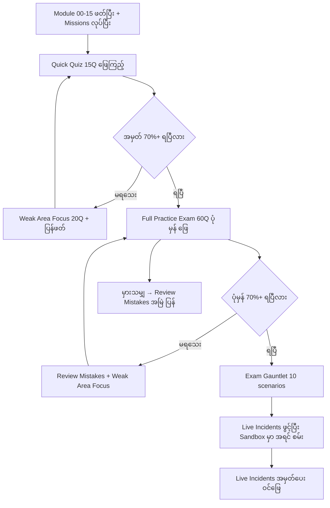
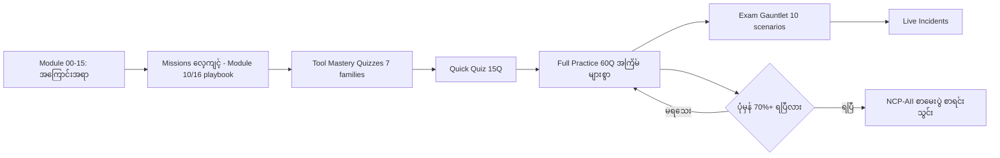

# Module 17 — Exam Modes, Tool Mastery & Live Incidents

## 1. ပြဿနာ — practice လုပ်ခြင်းနှင့် exam simulation က အတူတူ မဟုတ်ပါ

Module 00–16 မှာ အကြောင်းအရာနှင့် missions များ ပြီးပါပြီ — သို့သော် "ကိုယ် သိထားသည်" နှင့်
"စာမေးပွဲ အခြေအနေမှာ ပြသနိုင်သည်" ကွာပါသည်။ DC Lab Sim က ထိုကွာခြားချက်ကို ဖြည့်ရန်
လေ့ကျင့်မှု ပုံစံ ၃ မျိုး ပေးထားပါသည် —

- **Exam modes (Exams page)** — စာမေးပွဲ ပုံစံအမျိုးမျိုးဖြင့် မေးခွန်း ဖြေခြင်း
- **Tool Mastery Quizzes** — tool ရွေးချယ်မှုနှင့် tool output ဖတ်ရှုမှု ကျွမ်းကျင်မှု
- **Live Incidents** — အချိန်သတ်မှတ်ထားသော adaptive troubleshooting (အမှတ် ပေး၊ hint မပါ)

ပြဿနာမှာ — ဤ ၃ မျိုး က ကျွမ်းကျင်မှု မတူညီပါ။ mission တစ်ခု ဖြေရှင်းခြင်းက
"ဘာလုပ်ရမလဲ" ကို သင်ပေးပြီး၊ exam mode က "ဘယ်အဖြေ ရွေးရမလဲ" ကို စစ်ပါသည်၊
Tool Mastery က "ဘယ် tool က ဘယ်အချက်ကို ပြသလဲ" ကို စစ်ပါသည်၊
Live Incidents က "အချိန် ဖိအားအောက်မှာ စနစ်တကျ ဘယ်လို ရှာဖွေမလဲ" ကို စစ်ပါသည်။
အားလုံးကို လေ့ကျင့်မှ သာ စာမေးပွဲ အဆင်သင့် ဖြစ်ပါမည်။

## 2. Exam Modes ၅ မျိုး ⭐

DC Lab Sim ၏ Exams page တွင် mode ၅ မျိုး ရှိပါသည် — တစ်ခုချင်းစီက မေးခွန်း အရေအတွက်
နှင့် အချိန် သတ်မှတ်ချက် ကွဲပါသည်။

### 2.1 Full Practice Exam — 60 မေးခွန်း / 90 မိနစ် (RECOMMENDED)

- **ဘယ်အခါ သုံးမလဲ** — အကြောင်းအရာ အားလုံး ပြီးပြီးချင်း၊ တစ်ပတ်လျှင် တစ်ကြိမ် ပုံမှန်
- **strategy** — domain weighting ပါသောကြောင့် မေးခွန်း အများစုက D1 (31%) နှင့် D4 (33%) မှ
  လာပါမည် (Module 11 §2 ကြည့်)။ ပထမ အကြောင်းအရာ အားလုံး ဖြတ်ကြည့်ပြီး သေချာသော
  ချက်ချင်း ဖြေ၊ မသေချာသော ကို flag လုပ်ပြီး နောက်မှ ပြန်
- **အချိန် သင်္ချာ** — 90 ÷ 60 = **မေးခွန်း ၁ ခုလျှင် 1.5 မိနစ် (90 စက္ကန့်)**

### 2.2 Quick Quiz — 15 မေးခွန်း / 15 မိနစ်

- **ဘယ်အခါ သုံးမလဲ** — နေ့စဉ် အပူချိန် တိုင်းတာသလို — မနက် ၁၅ မိနစ် ဖြင့် အားနည်းချက်
  ချက်ချင်း သိရန်။ all domains မှ ကျပါသည်
- **strategy** — ဖြေနှုန်းထက် **အမြန်နှုန်း** ကို လေ့ကျင့်ခြင်း — 1 မိနစ်ထက် ကျော်ပါက
  ချန်ထားပြီး နောက်မှ ပြန် (real exam ထက် ပို တင်းကျပ်သော အချိန်)
- **အချိန် သင်္ချာ** — 15 ÷ 15 = **မေးခွန်း ၁ ခုလျှင် 1 မိနစ် (60 စက္ကန့်)**

### 2.3 Exam Gauntlet — weighted scenario ၁၀ ခု / 30–90 မိနစ်

- **ဘယ်အခါ သုံးမလဲ** — Full Practice တွင် 70%+ ပုံမှန် ရပြီးမှ — scenario အခြေခံ ဖြစ်၍
  မေးခွန်း တစ်ခုချင်း ထက် စိတ်ကူး အခြေအနေ တစ်ခုလုံး ကို ကိုင်တွယ်ရပါသည်
- **strategy** — domain-based scoring ဖြစ်သောကြောင့် အခြေအနေ တစ်ခုချင်းစီတွင်
  "ဘယ် domain က အမှတ် ရနေသလဲ" ကို သတိထား ဖြေပါ — တူညီသော scenario အမျိုးအစား
  (ဥပမာ — validation scenario) ကို အချိန် မကုန်အောင် မြန်မြန် ကိုင်တွယ်ပါ
- **အချိန် သင်္ချာ** — 30–90 ÷ 10 = **scenario ၁ ခုလျှင် 3–9 မိနစ်** (အချိန် ပေးသည့်ပေါ်
  မူတည် — ရှိသမျှ အချိန်ကို 10 ခု ညီညီ ခွဲပါ)

### 2.4 Weak Area Focus — 20 မေးခွန်း / 30 မိနစ်

- **ဘယ်အခါ သုံးမလဲ** — score 70% အောက် ကျသော domain များမှ သာ မေးခွန်း ကျသော
  ကြောင့် — ပြန်ဖတ်ပြီး ချက်ချင်း ဖြေရန် အကောင်းဆုံး
- **strategy** — မှားသော မေးခွန်း တစ်ခုချင်းစီတွင် "ဘယ် concept ကြောင့် မှားသလဲ"
  ကို မှတ်တမ်းတင်ပါ — ဖြေရွေးချက် ၂ ခု ကြား ရှုပ်ပါက သက်ဆိုင်ရာ module ပြန်ဖတ်ပါ
- **အချိန် သင်္ချာ** — 30 ÷ 20 = **မေးခွန်း ၁ ခုလျှင် 1.5 မိနစ်** (Full Practice နှင့် အတူတူ)

### 2.5 Review Mistakes — အကြိမ် အကန့်အသတ် မရှိ

- **ဘယ်အခါ သုံးမလဲ** — မှားဖူးသော မေးခွန်း အားလုံး ပြန်ဖြေရန် — အချိန် သတ်မှတ်ချက် မရှိပါ
- **strategy** — အမှတ် လိုက်ရန် မဟုတ် — မှားဖူးသော မေးခွန်း တစ်ခုချင်းစီ ကို
  "ဘာကြောင့် အဖြေ မှန်သလဲ" ရှင်းပြနိုင်မှ နောက်တစ်ခု ဆက်ပါ
- **အချိန် သင်္ချာ** — ကန့်သတ်ချက် မရှိ — **accuracy ကို ဦးစားပေး**ပါ

### 2.6 နှိုင်းယှဉ်ခြင်း

| Mode | မေးခွန်း/Scenario | အချိန် | တစ်ခုချင်း အချိန် | ဘယ်အခါ သုံးမလဲ | အဓိက ကျွမ်းကျင်မှု |
|---|---|---|---|---|---|
| **Full Practice** (RECOMMENDED) | 60Q | 90 မိနစ် | 1.5 မိနစ် | အပတ်စဉ် အပြည့် rehearsal | stamina + domain weighting ခံစားရန် |
| **Quick Quiz** | 15Q | 15 မိနစ် | 1 မိနစ် | နေ့စဉ် / ပြန်ဖတ်ပြီး | အမြန်နှုန်း + အားနည်းချက် ချက်ချင်း သိရန် |
| **Exam Gauntlet** | 10 scenarios | 30–90 မိနစ် | 3–9 မိနစ် | 70%+ ပုံမှန် ရပြီးမှ | scenario ကိုင်တွယ်မှု + domain-based scoring |
| **Weak Area Focus** | 20Q | 30 မိနစ် | 1.5 မိနစ် | domain တစ်ခု <70% ကျပါက | အားနည်း domain ပြန်ဖတ်ပြီး ချက်ချင်း အတည်ပြု |
| **Review Mistakes** | မှားဖူးသမျှ | အကန့်အသတ် မရှိ | — | အမြဲ (အထူးသဖြင့် ဖြေပွဲ မတိုင်မီ) | အမှား ထပ်မဖြစ်စေရန် |

📌 **real NCP-AII နှင့် နှိုင်းယှဉ်ချက်** — real exam က မေးခွန်း 70–75 ခု / 120 မိနစ် ≈
**1.6–1.7 မိနစ်/ခု** (Module 11)။ Full Practice က 1.5 မိနစ်/ခု — လက်တွေ့ စာမေးပွဲထက်
အနည်းငယ် တင်းကျပ်သောကြောင့် ဤနှုန်းဖြင့် လေ့ကျင့်ထားပါက real exam တွင် အချိန် ပိုရပါမည်။

### 2.7 ဘယ် mode ကို ဘယ်အဆင့်မှာ သုံးမလဲ



**Figure 1 — Exam mode decision flowchart (ဘယ် mode ကို ဘယ်အဆင့်မှာ သုံးမလဲ)**

**ပုံရှင်းလင်းချက်** — ဘယ် mode ကို ဘယ်အချိန်မှာ သုံးမလဲ ဆိုသော ဆုံးဖြတ်ချက် ဇယားဖြစ်ပါသည်။
ပထမ Quick Quiz ဖြင့် ကိုယ့်အဆင့် တိုင်းတာပါ — 70%+ မရသေးပါက Weak Area Focus နှင့်
ပြန်ဖတ်ပြီး ပြန်စမ်းပါ (ဘယ်အဆင့် ရောက်နေသည် ဆိုသည်ကို ဇယား အလယ်က node များက
ဆုံးဖြတ်ပေးပါသည်)။ Full Practice တွင် ပုံမှန် 70%+ ရပြီးမှ သာ Exam Gauntlet နှင့်
Live Incidents ဘက် ကူးပါ — ထိုအဆင့် ၂ ခုက ပို ခက်ပြီး အချိန် ဖိအား ပိုများသောကြောင့်
ဖြစ်ပါသည်။ ဘယ် အဆင့်မဆို Review Mistakes ကိုတော့ အမြဲ ပြန်ဖြေပါ — အမှားက
ပြန်လည် လေ့လာရန် အကောင်းဆုံး အရင်းအမြစ် ဖြစ်ပါသည်။

## 3. Tool Mastery Quizzes — 7 families ⭐⭐

Exam modes က "ဘယ်အဖြေ ရွေးမလဲ" ကို စစ်ပြီး၊ Tool Mastery က **"ဘယ် tool ကို
ဘယ်အခါ သုံးမလဲ"** နှင့် **"tool output က ဘာ ပြောနေသလဲ"** ကို စစ်ပါသည် —
NCP-AII တွင် မေးခွန်း အများစုက ဤ ပုံစံ ဖြစ်ပါသည် (Module 11 §4 trap 4/5 ကြည့်)။

Family ၇ ခု ရှိပြီး တစ်ခုချင်းစီတွင် quiz ၂ ဆင့် ရှိပါသည် —

- **Tool Selection (10 မေးခွန်း)** — အခြေအနေ ပေးပြီး မှန်ကန်သော tool ရွေးခိုင်းခြင်း
- **Deep Mastery (25 မေးခွန်း)** — flag များ၊ output field များ၊ ရလဒ် ဖတ်ရှုမှု ကို အနက်ရှိုင်းဆုံး စစ်ခြင်း

⚠️ အောက်ပါ "likely tool set" များသည် ဤ course အကြောင်းအရာ (Module 01–15) ပေါ်
အခြေခံ၍ ခန့်မှန်းထားခြင်း ဖြစ်ပါသည် — **simulator က သတ်မှတ်ထားတဲ့ tool list ကို
ပလက်ဖောင်းပေါ် အတည်ပြုပါ**။ family တစ်ခုချင်းစီ၏ tool အရေအတွက် (4/4/3/4/3/3/4) က
site တွင် ဖော်ပြထားသော အချက်အလက် ဖြစ်ပါသည်။

### 3.1 GPU Monitoring (4 tools)

- **ဘာ စစ်သလဲ** — GPU အခြေအနေ၊ utilization၊ memory၊ performance metrics ကို
  real-time နှင့် on-demand မည်သို့ ကြည့်ရမလဲ
- **likely tool set** — `nvidia-smi`၊ `dcgmi` (discovery/dmon)၊ `nvsm`၊ DCGM telemetry
  (tool ၄ ခု — အတိအကျ စာရင်းကို ပလက်ဖောင်းပေါ် အတည်ပြုပါ)
- **မှတ်ရန် flags / output fields** (Module 01–02) —
  - `nvidia-smi --query-gpu=index,temperature.gpu,power.draw --format=csv` —
    field များကို ရွေးချယ် တောင်းဆိုခြင်း (CSV output)
  - `nvidia-smi -q -d TEMPERATURE / POWER / ECC` — section အလိုက် အသေးစိတ်
  - `dcgmi discovery -l` — GPU အားလုံး မြင်ရမှု · `dcgmi dmon -e 1001,1002,...` —
    field ID ဖြင့် live monitoring
  - `nvsm show health` — system-level ကျန်းမာရေး
  - **အဓိက ခွဲခြားရန်** — GPU utilization (graphics engine active) vs memory utilization
    (DRAM active) — ၂ ခု မတူပါ
- **study method** — Sandbox တွင် workload apply ပြီး `dcgmi dmon` နှင့်
  `nvidia-smi` ကို တစ်ပြိုင်နက် ကြည့်ပါ — "ဘယ် field က ဘယ်အခါ ရွေ့သလဲ" မှတ်ပါ

### 3.2 InfiniBand Tools (4 tools)

- **ဘာ စစ်သလဲ** — GPU-to-GPU communication အတွက် InfiniBand high-speed
  networking ကို စီမံခန့်ခွဲ/ပြဿနာ ရှာဖွေခြင်း
- **likely tool set** — `ibstat`၊ `ibstatus`၊ link inspection tool (ဥပမာ `iblinkinfo`)၊
  link test tool (ဥပမာ `ibping`) — တိုက်ရိုက် စာရင်းကို ပလက်ဖောင်းပေါ် အတည်ပြုပါ
- **မှတ်ရန် flags / output fields** (Module 06, 12, 15) —
  - `ibstat` — port **State** (Active/Down) နှင့် **Rate** — DGX A100 တွင် **HDR 200Gb/s**၊
    H100 မျိုးဆက်တွင် **NDR 400Gb/s** (Module 06)
  - link က full speed မရောက်ပါက — cable/transceiver နှင့် signal quality
    (error counter / BER) ကို ဆက်စစ်ပါ (Module 12 §4.4)
  - **အဓိက ခွဲခြားရန်** — link State က Active ဖြစ်သော်လည်း Rate က မျှော်မှန်းထားသော
    speed မရောက်ပါက "link တက်သည်" ≠ "link မှန်ကန်စွာ တက်သည်"
- **study method** — Module 06 ၏ sandbox drill အတိုင်း `ibstat` run ပြီး port state နှင့်
  rate ကို မှတ်တမ်းတင်ပါ — Fault injection (NVLink Down) ပြီး ပြန်တိုင်းပါ

### 3.3 BMC & Hardware (3 tools)

- **ဘာ စစ်သလဲ** — DGX/HPC server များပေါ်က BMC access၊ hardware sensors၊
  system inventory
- **likely tool set** — `ipmitool`၊ `dmidecode`၊ system info tool တစ်ခု —
  တိုက်ရိုက် စာရင်းကို ပလက်ဖောင်းပေါ် အတည်ပြုပါ
- **မှတ်ရန် flags / output fields** (Module 07) —
  - `ipmitool sensor list` — sensor အားလုံး (temp, voltage, fan) — inlet temp, fan RPM,
    12V rail ကဲ့သို့ reading များ ပုံမှန် range အတွင်း ရှိ/မရှိ
  - `ipmitool sel list` — **SEL** (System Event Log) — hardware event သမိုင်း
  - `ipmitool chassis power cycle / power status` — power control
    (⚠️ workload ပျက်မည် — ကြိုတင် စဉ်းစားပြီးမှ)
  - `dmidecode` — hardware inventory (model, serial, memory)
  - **အဓိက ခွဲခြားရန်** — `ipmitool` က OS ပေါ်က GPU tool များနှင့် သီးခြား
    (BMC/OOB level) — GPU ကျန်းမာရေး မဟုတ်၊ chassis ကျန်းမာရေး
- **study method** — `ipmitool sensor list` ထဲက reading ၃ ခု ရွေးပြီး "ဘာကို တိုင်းသလဲ"
  ရှင်းကြည့်ပါ (Module 07 exercise ကဲ့သို့)

### 3.4 Slurm Cluster Tools (4 tools)

- **ဘာ စစ်သလဲ** — job scheduling၊ queue management၊ cluster administration
- **likely tool set** — `sinfo`၊ `squeue`၊ `sacct`၊ `scontrol` (module 08/14 မှ
  ဖုံးလွှမ်းပြီး — flag အသေးစိတ်ကို ပလက်ဖောင်းပေါ် အတည်ပြုပါ)
- **မှတ်ရန် flags / output fields** (Module 08) —
  - `sinfo` — partition/node state (idle/down/drained ကဲ့သို့) ကြည့်ရန်
  - `squeue` — လက်ရှိ job များ (pending/running) — user အလိုက် စစ်ထုတ်ခြင်း
  - `sacct` — job ပြီးဆုံးမှု သမိုင်းနှင့် accounting
  - `scontrol` — partition/GRES/node configuration ဖတ်/ပြင်ခြင်း
  - GPU request — `--gres=gpu:N` (Glossary ရှိ GRES)
  - **အဓိက ခွဲခြားရန်** — node state အမျိုးအစားများကို ဖတ်တတ်ခြင်း —
    idle ≠ down ≠ drained (maintenance)
- **study method** — Slurm missions (The Slurm Setup / Standing Up the Scheduler)
  ပြန်လုပ်ပြီး တစ်ခုချင်းစီ output ကို ခွဲခြား ဖတ်ကြည့်ပါ

### 3.5 Container Tools (3 tools)

- **ဘာ စစ်သလဲ** — GPU-accelerated workload များအတွက် container runtime နှင့်
  tools ကို စီမံခြင်း
- **likely tool set** — `docker`၊ `enroot`၊ Pyxis/Slurm integration (`srun` flags) —
  တိုက်ရိုက် စာရင်းကို ပလက်ဖောင်းပေါ် အတည်ပြုပါ
- **မှတ်ရန် flags / output fields** (Module 14) —
  - `docker run --gpus all nvidia/cuda:12.x nvidia-smi` — container ထဲမှ GPU
    မြင်/မမြင် စမ်းသပ်ခြင်း ⭐
  - `nvidia-ctk runtime configure --runtime=docker` + docker restart —
    GPU container support ဖွင့်ခြင်း
  - NGC container များကို Slurm အောက်တွင် enroot/Pyxis ဖြင့် run ခြင်း
    (mission "Container Runtime: Docker, Enroot & Pyxis with NGC")
  - **အဓိက ခွဲခြားရန်** — "CUDA initialization error" က runtime configuration
    ပြဿနာ ဖြစ်နိုင် — install → configure → restart အဆင့် တစ်ဆင့်ချင်း ပြန်စစ်ပါ
- **study method** — "Container Crisis" mission ပြန်လုပ်ပြီး failure မှ success အထိ
  အဆင့် မှတ်ပါ

### 3.6 Diagnostics & Testing (3 tools)

- **ဘာ စစ်သလဲ** — GPU health diagnostic၊ stress testing၊ support bundle စုဆောင်းခြင်း
- **likely tool set** — `dcgmi diag`၊ support bundle tool (ဥပမာ `nvbug-report`)၊
  GPU stress/burn tool — တိုက်ရိုက် စာရင်းကို ပလက်ဖောင်းပေါ် အတည်ပြုပါ
- **မှတ်ရန် flags / output fields** (Module 02, 15) —
  - `dcgmi diag -r 1` — level 1: quick health · `-r 2` — standard · `-r 3` — deep
    (အချိန် ကြာပြီး ပို ကျယ်ပြန့်)
  - `dcgmi health -s` — health watch enable အခြေအနေ · `dcgmi health -g` — violations
  - diagnostic levels ကို acceptance test အဆင့်များနှင့် ချိတ်ဆက် မှတ်ပါ
    (Module 15 — quick → standard → deep)
  - **အဓိက ခွဲခြားရန်** — `-r 1` က မြန်သော်လည်း အားလုံး မစစ်နိုင် —
    certification/acceptance အတွက် deep level လိုအပ်နိုင်
- **study method** — Sandbox တွင် ECC Error inject ပြီး `dcgmi diag -r 1` ပြန် run —
  ရလဒ် ပြောင်း/မပြောင်း ကြည့်ပါ (Module 02 exercise)

### 3.7 XID Diagnostics (4 tools)

- **ဘာ စစ်သလဲ** — system log ထဲက XID error များကို identify/triage/respond လုပ်ခြင်း
- **likely tool set** — `dmesg`၊ `nvidia-smi`၊ `dcgmi`၊ XID reference/lookup —
  တိုက်ရိုက် စာရင်းကို ပလက်ဖောင်းပေါ် အတည်ပြုပါ
- **မှတ်ရန် flags / output fields** (Module 03, 10 — site ၏ XID reference 28 codes) —
  - `dmesg | grep -i xid` — kernel log မှ XID entry ရှာခြင်း
  - **[Exam]-tagged XID များ** ကို ဦးစားပေး မှတ်ပါ —
    79 (GPU fallen off bus) · 74/76/77/78 (NVLink error/training/timeout/ECC) ·
    48 (double-bit ECC) · 64 (row remapping failure) · 38 (driver-FW mismatch) ·
    54 (auxiliary power) · 43 (GPU stopped responding) · 92 (high single-bit ECC) ·
    27 (memory interface) · 13 (graphics engine)
  - severity ခွဲခြားခြင်း — Critical (79, 48, 74–78, 64, 38, 54, 95) vs
    Warning (43, 92, 13) vs Informational (63, 45)
  - **အဓိက ခွဲခြားရန်** — XID code က အမှား အမျိုးအစား ပြသည်၊ ဖြေရှင်းနည်း
    မဟုတ် — code → severity → action (reset/reseat/replace) အဆင့် ဆင်းပါ
- **study method** — site ၏ XID Error Code Reference (28 codes) ကို severity အလိုက်
  အုပ်စု ခွဲ မှတ်ပါ — [Exam] tag ပါသော ကို အရင်

### 3.8 Family များ နှိုင်းယှဉ်ခြင်း

| Family | Tools | Quiz ပေါင်း | ဘာ စစ်သလဲ | ပြန်ကြည့်ရန် Module |
|---|---|---|---|---|
| GPU Monitoring | 4 | 10 + 25 = 35Q | real-time/on-demand metrics | 01, 02 |
| InfiniBand Tools | 4 | 10 + 25 = 35Q | IB fabric link state/speed | 06, 12 |
| BMC & Hardware | 3 | 10 + 25 = 35Q | sensors, inventory, SEL | 07 |
| Slurm Cluster Tools | 4 | 10 + 25 = 35Q | scheduling/queue/admin | 08 |
| Container Tools | 3 | 10 + 25 = 35Q | GPU container runtime | 14 |
| Diagnostics & Testing | 3 | 10 + 25 = 35Q | diag levels, stress, support | 02, 15 |
| XID Diagnostics | 4 | 10 + 25 = 35Q | XID identify/triage | 03, 10 |

📌 **Tool Selection (10Q)** က ပထမ ဖြေပါ — "ဘယ် tool ကို သုံးမလဲ" ကို မသိပါက
Deep Mastery ရှိ flag များ မှတ်ထားရုံနှင့် မလုံလောက်ပါ။ တစ်ပတ်လျှင် family ၁–၂ ခု
နှုန်းဖြင့် အပြီး ဖြေပါ — ဖြေပွဲ မတိုင်မီ အားလုံး တစ်ပြိုင်နက် ပြန်ဖြေပါ။

## 4. Live Incidents — timed adaptive troubleshooting ⭐⭐

Live Incidents က mission များနှင့် မတူပါ — **အချိန် သတ်မှတ်ထားပြီး အမှတ် ပေးသည်၊
hint မပါပါ**။ အခြေအနေ က ယခင် ဖြေရှင်းမှု ပေါ် မူတည်၍ ပြောင်းနိုင် (adaptive) သောကြောင့်
"စာ ကျက်ထားသော ဖြေရှင်းနည်း" က မလုံလောက်ပါ။

### 4.1 စည်းမျဉ်းများ (site အချက်အလက်)

- **Unlock** — mission ၃ ခု ပြီး + quiz ၂ ခု အောင်ပြီးမှ ဖွင့်ပါသည်
- **Skill rating** — **1000** မှ စပါသည် (ELO ကဲ့သို့ rating စနစ်)
- **Domain filter** — Any Domain / Domain 1–5 — အားနည်း domain ကို သီးခြား လေ့ကျင့်နိုင်
- **Free unscored practice** — Simulator ရှိ **Sandbox tab** (fault injection:
  XID Error, ECC Error, Thermal Issue, NVLink Down + Clear All, Surprise me —
  physical actions: Reseat GPU, Reseat NVLink bridge, Mark for RMA)

⚠️ **သတိပြုရန်** — Live Incidents က **အမှတ် ပေးသော စနစ်** ဖြစ်ပါသည် —
Sandbox tab တွင် အရင် မလေ့ကျင့်ဘဲ တိုက်ရိုက် ဝင်ပါက rating ကို ကိုယ်တိုင် ကျစေနိုင်ပါသည်။

### 4.2 Incident triage အစဉ် ⭐

မည်သည့် incident မဆို အောက်ပါ အစဉ်အတိုင်း ဆင်းပါ — လမ်းကြောင်း မှားပါက
အချိန် အများဆုံး ကုန်ပါသည် —

1. **State** — `nvidia-smi` / `dcgmi discovery -l` / `sinfo` — ဘယ် GPU/node က
   ဘယ် အခြေအနေ — symptom အားလုံး အရင် စုပါ
2. **Logs** — `dmesg | grep -i xid` — XID code ရှာပြီး severity ခွဲပါ
   (XID code က စုံစမ်းစစ်ဆေးမှု လမ်းကြောင်း သတ်မှတ်ပေးပါသည်)
3. **Fabric** — `ibstat` (State/Rate) · `nvidia-smi nvlink -s` — communication path
   ကျန်းမာရေး စစ်ပါ
4. **Physical** — `ipmitool sensor list` — chassis/cooling/power level —
   လိုအပ်ပါက Reseat GPU / Reseat NVLink bridge / Mark for RMA (Module 07)

```mermaid
flowchart TD
    A[Incident ရရှိ] --> B[State: nvidia-smi / dcgmi discovery / sinfo]
    B --> C[Logs: dmesg | grep -i xid → XID code + severity]
    C --> D[Fabric: ibstat State/Rate · nvidia-smi nvlink]
    D --> E[Physical: ipmitool sensor list]
    E --> F{ပြဿနာ အမျိုးအစား သိပြီလား}
    F -- Software/driver --> G[reset / restart / driver-FW verify]
    F -- Fabric --> H[link/cable/transceiver ပြင်]
    F -- Hardware --> I[Reseat → power cycle → Mark for RMA]
    G --> J[validate: nvidia-smi + dcgmi diag]
    H --> J
    I --> J
```

**Figure 2 — Live Incidents triage အစဉ် (State → Logs → Fabric → Physical)**

**ပုံရှင်းလင်းချက်** — incident triage အစဉ်ကို ပြသထားခြင်း ဖြစ်ပါသည်။
အပေါ်မှ အောက်သို့ — State မှ စပြီး Logs → Fabric → Physical အထိ တစ်ဆင့်ချင်း
ဆင်းပါ (ဖြေရှင်းနည်း ၃ မျိုး ကွဲသော node များ)။ ဆုံးဖြတ်ချက် node က
ပြဿနာ အမျိုးအစား ပေါ် မူတည်၍ လမ်းကြောင်း ခွဲပေးပြီး၊ အားလုံးက validate
(နောက်ဆုံး node) တွင် ပြန်ဆုံပါသည် — ဖြေရှင်းပြီး စစ်ဆေးပြီးမှ ပြီးဆုံးပါ။
မည်သည့် အဆင့်ကိုမဆို ကျော်ပါက အချိန် ဖိအားအောက်တွင် လမ်းကြောင်း မှားတတ်ပါသည်။

### 4.3 Speed drills နှင့် score bands

- **Speed drill** — Sandbox တွင် fault inject ပြီး အပေါ်ပါ ၄ အဆင့် ကို
  အချိန် တိုင်းပြီး လုပ်ကြည့်ပါ — ပထမ "diagnosis အချိန်" ကို တိုးတက်အောင်
  လုပ်ပါ (fix ထက် ရှာဖွေမှု က ပို အချိန်ကုန်လေ့ ရှိပါသည်)
- **Score bands (conceptual)** — skill rating 1000 က baseline ဖြစ်ပြီး —
  မြန်/မှန်/hint မသုံးဘဲ ဖြေရှင်းနိုင်ပါက တက်၊ နှေး/မှား/အချိန် ကုန်ပါက ကျပါသည်
  (ELO ကဲ့သို့)။ **1000 အောက်** = ဆက်လေ့ကျင့်ရန် · **1000 ခန့်** = ပုံမှန် အဆင့် ·
  **1000 အထက်** = ကျွမ်းကျင် — အတိအကျ band နှင့် rating ပြောင်းလဲမှု စည်းမျဉ်းကို
  site က မဖော်ပြပါ (needs verification)

## 5. Readiness Ladder — ဘယ်အဆင့် ဘယ်အခါ ⭐

စာမေးပွဲ မဖြေမီ အဆင့် အစဉ်ကို အောက်ပါ အတိုင်း တက်ပါ —



**Figure 3 — Readiness ladder (စာမေးပွဲ မတိုင်မီ အဆင့် အစဉ်)**

**ပုံရှင်းလင်းချက်** — ဘယ်အဆင့်ကို ဘယ်အခါ လုပ်မလဲ ဆိုသော readiness ladder
ဖြစ်ပါသည်။ အောက်ခြေမှ အပေါ်သို့ — အကြောင်းအရာ (Module 00–15) → missions
(Module 10/16 playbook) → Tool Mastery → Quick Quiz → Full Practice အကြိမ် များစွာ →
Gauntlet → Live Incidents အထိ တစ်ဆင့်ချင်း တက်ပါ။ **ပုံမှန် 70%+** ရမှ သာ
NCP-AII စာမေးပွဲ စာရင်းသွင်းပါ (decision node) — မရသေးပါက Full Practice ဘက်
ပြန်ဆင်းပြီး ဆက်လေ့ကျင့်ပါ။

📌 အမှတ် 70%+ ဆိုသည်မှာ **အနည်းဆုံး threshold** ဖြစ်ပါသည် —
Module 11 ၏ အကြံပြုချက် အတိုင်း ပို လုံခြုံသော margin အတွက် **85%+** ပုံမှန် ရအောင်
လေ့ကျင့်ပြီးမှ ဖြေဆိုပါက ပို ကောင်းပါသည် (passing score ကို NVIDIA က မထုတ်ပြန်ပါ)။

## 6. Self-Check

1. Full Practice Exam နှင့် Quick Quiz တွင် မေးခွန်း ၁ ခုအတွက် အချိန် budget
   မည်မျှ ကွာပြီး ဘယ်ဟာက ဘာကို လေ့ကျင့်ပေးသလဲ?
2. Tool Mastery family တစ်ခုချင်းစီတွင် quiz ဘယ်နှစ် မျိုး ရှိပြီး ဘာ ကွာသလဲ?
3. Live Incidents ဖွင့်ရန် ဘာ ပြည့်စုံရမလဲ — နှင့် ဘာကြောင့် Sandbox ကို အရင် သုံးသင့်သလဲ?
4. Incident triage အစဉ် ၄ အဆင့် က ဘာတွေလဲ?
5. စာမေးပွဲ စာရင်းသွင်းမီ Full Practice တွင် မည်မျှ ပုံမှန် ရသင့်သလဲ?

**အဖြေ** —
1) Full Practice = 1.5 မိနစ်/ခု (stamina + domain weighting)၊ Quick Quiz = 1 မိနစ်/ခု
   (အမြန်နှုန်း + အားနည်းချက် ချက်ချင်း သိရန်)။
2) ၂ မျိုး — Tool Selection (10Q: ဘယ် tool ရွေးမလဲ) + Deep Mastery (25Q: flag/output
   ဖတ်ရှုမှု)။
3) mission ၃ ခု ပြီး + quiz ၂ ခု အောင်ရမည် — အမှတ် ပေးစနစ် ဖြစ်၍ rating မကျစေရန်
   အခမဲ့ Sandbox တွင် အရင် လေ့ကျင့်သင့်ပါသည်။
4) State (nvidia-smi/dcgmi/sinfo) → Logs (dmesg XID) → Fabric (ibstat/nvlink) →
   Physical (ipmitool) — ပြီးမှ validate။
5) အနည်းဆုံး ပုံမှန် 70%+ (Module 11 က 85%+ margin အကြံပြု)။

## 7. References

- DC Lab Sim — Exams page (exam modes) · Labs page (Live Incidents) ·
  Docs > Commands (214 commands) · Docs > XID Error Code Reference (28 codes)
- Module 11 — Exam Readiness (blueprint weights, exam format)
- Module 10/16 — Missions playbook
- NCP-AII official: https://www.nvidia.com/en-us/learn/certification/ai-infrastructure-professional/

## Technical review notes

- §2 ၏ exam mode အချက်အလက် အားလုံး (60Q/90min၊ 15Q/15min၊ 10 scenarios/30–90min၊
  20Q/30min၊ Review Mistakes unlimited) နှင့် §4 ၏ Live Incidents စည်းမျဉ်းများ
  (unlock: 3 missions + 2 quizzes၊ rating 1000၊ domain filter) သည်
  dclabsim.com မှ 2026-10-14 တွင် ဖမ်းယူထားသော အချက်အလက် ဖြစ်ပြီး
  site update နှင့်အတူ ပြောင်းလဲနိုင် — ဖြေဆိုမီ ပြန်စစ်ပါ။
- §3 ၏ "likely tool set" များသည် course အကြောင်းအရာ ပေါ် ခန့်မှန်းထားခြင်း ဖြစ်ပြီး
  simulator က သတ်မှတ်ထားသော တိကျ tool စာရင်း မဟုတ်ပါ — ပလက်ဖောင်းပေါ်
  အတည်ပြုပါ (needs verification)။ family တစ်ခုချင်းစီ၏ tool အရေအတွက်
  (4/4/3/4/3/3/4) နှင့် quiz အရေအတွက် (10Q + 25Q) ကတော့ site တွင် ဖော်ပြထားသော
  အချက်အလက် ဖြစ်ပါသည်။
- §3.4/3.5 ရှိ Slurm/Container flags အသေးစိတ် (sacct/scontrol options၊ enroot/Pyxis
  flag များ) သည် လူသိများသော အသုံးအနှုန်းများ ဖြစ်သော်လည်း simulator တွင်
  ပံ့ပိုးထားသော exact flags ကို ပလက်ဖောင်းပေါ် အတည်ပြုပါ (needs verification)။
- §4.3 ရှိ score band ဖော်ပြချက်များ (<1000 / ~1000 / >1000) သည် ELO ကဲ့သို့
  rating စနစ် အပေါ် conceptual ခန့်မှန်းချက် ဖြစ်ပြီး site က တိကျ band များ
  မဖော်ပြပါ — needs verification။
- §5 ရှိ 70%+ threshold သည် အနည်းဆုံး gate ဖြစ်ပြီး Module 11 က 85%+ margin
  အကြံပြုထားပါသည် — NVIDIA က passing score မထုတ်ပြန်ပါ။
